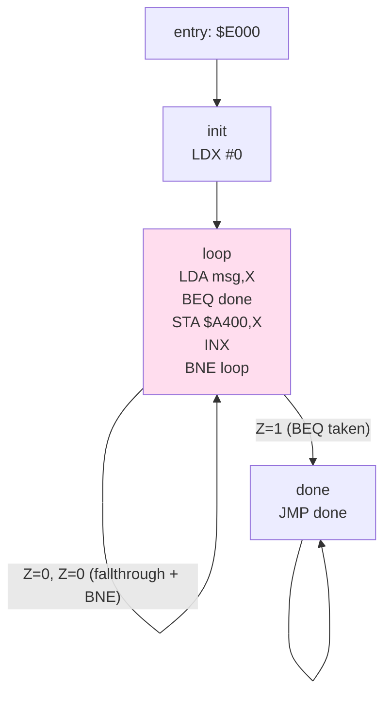

# go6asm — Design Document

> A 6502 cross-assembler in Go, with a strict ca65-compatible syntax subset,
> a relocatable object format, a separable linker, and first-class WASM support
> for in-browser editors and simulators.

**Status:** Implemented through Phase 3 (byte-verified against cc65 V2.18 —
ca65 + ld65 — and executed on the beevik/go6502 Klaus oracle); Phase 4 in
progress. See §16 for the live roadmap.
**Target audience:** the implementer (you), future contributors, and anyone
embedding the assembler in another Go program or a web page.

---

## 1. Goals and non-goals

### Goals

- **Strict ca65 syntax subset.** Source files that assemble under `go6asm`
  must also assemble (with identical bytes) under ca65, for any feature
  go6asm claims to support. Compatibility flows one way: ca65 → go6asm may
  fail; go6asm → ca65 must succeed.
- **6502 first.** NMOS 6502 only at v1. 65C02 and 65816 are pluggable ISA
  modules added later behind the same code path.
- **À la carte tooling.** The assembler does not know what a SID file, a PNG,
  or a C64 BASIC stub is. Companion CLIs convert those to assembleable data;
  the assembler just assembles.
- **Relocatable objects + linker.** The default pipeline is `asm → .o → ld → .bin`.
  A direct `asm → .bin` shortcut exists for simple one-file programs, but the
  object format and linker exist from day one so we never retrofit relocations.
- **First-class WASM.** A single `go6asm.Assemble(source string) Result`
  entry point that works identically in native, `js/wasm`, and `wasi/wasm`
  builds, with no filesystem dependencies in the wasm path.
- **Integrates with `6502-sim-tui`.** Output structure matches what the
  simulator's Memory/Disasm windows already consume via `bus.Labeller` and
  `asm.Symbol`, so an assembled program lights up the existing introspection
  UI without bespoke glue.
- **Excellent diagnostics.** Every error carries `File:Line:Col`, multiple
  errors per pass, source-line context with a caret. Better diagnostics than
  any existing 6502 assembler is an explicit goal.

### Non-goals

- Not a scripting language. No JavaScript-like DSL like Kick Assembler.
  Build-time data generation belongs in separate Go programs that emit
  `.byte` data, included via `.incbin` or `.include`.
- Not bug-for-bug ca65. Identical accepted bytes for accepted source, but
  some ca65 corners (segment overlays with weird mathematical fill rules,
  ulabel quirks, etc.) are explicitly out of scope unless requested.
- Not a C compiler. cc65 is the C compiler; go6asm is just the assembler
  half. (Long-term it would be nice if cc65's output assembled here, but
  that's a stretch goal, not v1.)
- No GUI. The assembler is a library + CLI + wasm export. Editors are
  separate.

---

## 2. Build order and re-evaluation points

This document describes a fairly large system. Most of it should not be
built before some of it has been used. This section exists to keep us
honest about the difference between *directional decisions* (which we are
making now, in this doc) and *binding commitments* (which we make later,
in code, after evidence).

### 2.1 The directional vs. committed distinction

Everything in this document is **directional** unless it appears in a
shipped, tagged release. Naming, schemas, formats, even the layered
authoring model — these are the current best plan, not promises. The
phrase "we commit to X" elsewhere in this document should be read as "we
plan to commit to X *when we ship the relevant phase*."

This isn't hedging. It's how to avoid the trap of designing a v2 system
before shipping v1. Every commitment we make in code is permanent in a way
that document commitments are not, and pretending otherwise leads to
either over-building (shipping the whole vision at once) or paralysis
(re-litigating decisions because the doc said they were settled).

### 2.2 What to build first

Strict priority order. Each item only starts after the previous one is
*usable*, not just complete.

1. **The core NMOS 6502 assembler.** Lex, parse, sema, codegen. Direct
   binary output. Strict-ish ca65 syntax for the basics: labels,
   instructions, expressions, `.byte`, `.word`, `.res`, `.org`, `.include`,
   `.incbin`, `.asciiz`, `=` constants. No macros, no segments, no object
   files. Diagnostics with `File:Line:Col` and source context.

   **Done when:** Klaus Dormann's functional test assembles (bytes diffed
   against ca65) and *executes* cleanly on a neutral, test-only executor
   (beevik/go6502). sim-tui is explicitly **not** a Phase 1 dependency;
   running go6asm output on sim-tui's vetted interp is a consumer-side
   integration test that arrives with sim-tui integration (Phase 4+).

2. **WASM build of (1).** The same assembler, callable from JS. No
   filesystem dependency. Integrate it into the simulator's existing web
   build as a basic editor pane.

   **Done when:** a user can edit `.s` source in the browser and see the
   bytes execute on the simulator.

This is the v0.1 milestone. Everything else in this document — macros,
segments, object format, linker, layered authoring, program model,
projections, MCP — comes after. Not because they're not valuable, but
because (1) and (2) together are the smallest thing that proves the rest
is worth building.

After v0.1, the next priority order is:

3. **Macros, scopes, conditionals.** Real users will hit the missing
   features fast; add what they need.
4. **Object format + linker.** Once any user has more than one source
   file, this becomes urgent.
5. **Hardware descriptors + the strict ca65 commitment.** Make the target
   declarative, then formalize the syntax compatibility contract against
   real programs.
6. **Layered authoring (§11).** Now that targets are declarative,
   inference rules have something to read.
7. **Program model + projections (§12).** The model only becomes useful
   when there are real programs to project from. Build it against
   accumulated examples, not against speculative needs.
8. **Capability protocol / MCP (§13).** The assembler has to be worth
   talking to before exposing it as a tool.

Each step's design should be revisited at the time it's built, using the
evidence accumulated from the previous steps.

### 2.3 Specific things to reconsider before committing

These are items in the doc where the current proposal is plausible but
not yet earned. Each one should be re-evaluated before its implementing
phase starts, not before. They're listed here so we don't forget to ask.

- **Strict ca65 byte-identical compatibility (§6.5).** Maintaining
  byte-identical output is a substantial ongoing tax — every PR runs the
  compat suite, every directive needs ca65-behavior reverse engineering.
  Before Phase 3, ask: is "behaviorally compatible with documented ca65
  semantics; byte-identical for the documented core subset" enough? It
  might be 80% of the value at 30% of the cost.

- **The Program Model as a typed Go package (§12.1).** The model could
  ship as a *documented JSON schema* with the assembler emitting JSON and
  separate small tools consuming it, rather than as a `pkg/model` package
  imported everywhere. Before Phase 4, ask: does the model need to be a
  Go type, or just a schema? Schema-only is more swappable.

- **The bundled stdlib (§11.6).** Shipping `std:print` means owning its
  behavior forever; improvements become breaking changes. Before Phase 5,
  ask: should v1.0 ship *one* stdlib module to feel the maintenance
  weight before adding more? `go6asm stdlib show` lets users copy and
  pin, which is the escape valve, but only if the stdlib is small enough
  to do that meaningfully.

- **Stable diagnostic codes (§14, e.g. `E0014`).** Code stability is great
  in mature tools and aspirational in v1. Before Phase 5, ask: ship v1
  with good *messages* and no codes; introduce codes in v1.x once the
  error taxonomy is real.

- **The Hardware Descriptor's behavioral fields (§12.4).** Currently the
  descriptor captures memory and registers but not *semantics* (e.g.,
  "write of `$03` to `VIC.Cmd` shifts left"). Behavioral facts would make
  prompts and diagnostics dramatically smarter, but expanding the schema
  before we know which facts matter is premature. Before Phase 3, ask:
  what's the minimum behavioral vocabulary we need, and is it a small
  enum (`shift_left`, `clear`, `trigger`) or open-ended?

- **The divergence/merge story (§12.8).** "Show the diff, don't resync"
  is the right philosophy, but the actual merge UI is unspecified. Before
  designing it, ask: does anyone actually edit the diagram? If everyone
  only edits source, the merge problem is theoretical.

- **Two wasm binaries vs. one (§10.5).** Decided "two" for progressive
  loading. Before Phase 4, ask: in practice, does the simulator's web
  build want one combined binary for simpler deployment? Bundle-size
  budget is the deciding factor.

### 2.4 What this means for the rest of the doc

Sections 3 through 16 describe the system *as if* all of it will be
built. That's how design documents work — they have to depict a coherent
whole to be useful. But the depiction is not the schedule. Read
everything that follows through this lens: "this is what the system looks
like if we build it the way the doc suggests, and we'll decide whether
to build it that way when we get there."

Sections marked with **(Phase N)** annotations have a recommended order;
the priority list in §2.2 overrides those if they disagree. When in
doubt, ship less.

---

## 3. Why another one

Of the actively maintained 6502 assemblers:

- **ca65** is the gold standard, but it's C, single-binary, hard to embed
  in a Go program or browser, and its error messages are functional but
  unremarkable.
- **64tass** and **Kick Assembler** are powerful but assembler-centric:
  scripting and graphics baked in.
- The Go-language options (beevik/go6502, taeber/a2asm, zellyn/go6502) are
  either Merlin-style, hobby-scale, or tied to a specific emulator host.

There's room for: ca65-compatible syntax + clean Go library + WASM-native +
modern diagnostics, with the assembler kept small and à la carte. That's
this project.

---

## 4. Architecture overview

```
                        ┌─────────────────────────┐
                        │     cmd/go6asm          │  CLI entry
                        │     cmd/go6ld           │  linker CLI
                        │     cmd/go6dump         │  object inspector
                        └────────────┬────────────┘
                                     │
        ┌────────────────────────────┼────────────────────────────┐
        │                            │                            │
        ▼                            ▼                            ▼
┌──────────────┐            ┌──────────────┐            ┌──────────────┐
│  pkg/asm     │            │  pkg/link    │            │  pkg/format  │
│              │            │              │            │              │
│  parse →     │   .o       │  resolve     │   .bin     │  raw, prg,   │
│  semantic →  ├───────────▶│  segments    ├───────────▶│  nes, xex,   │
│  codegen     │            │  + relocs    │            │  hex, srec   │
└──────┬───────┘            └──────┬───────┘            └──────────────┘
       │                           │
       ▼                           ▼
┌──────────────┐            ┌──────────────┐
│  pkg/object  │            │  pkg/memmap  │
│   .o I/O     │            │  config DSL  │
└──────────────┘            └──────────────┘
       │                           │
       └──────────────┬────────────┘
                      │
                      ▼
              ┌──────────────┐
              │  pkg/isa     │   ISA tables (6502 v1; 65C02/65816 pluggable)
              └──────┬───────┘
                     │
                     ▼
              ┌──────────────┐
              │  pkg/source  │   Pos, FileSet, Diagnostic, source caret
              └──────────────┘

              ┌──────────────────────────────────────────┐
              │  pkg/wasm  (build tag js,wasm)           │
              │  exports Assemble/Link to JS via syscall │
              │  /js. No filesystem dependency.          │
              └──────────────────────────────────────────┘
```

**Layering rules:**

- `token`, `isa`, and `expr` are leaves; nothing above them imports
  anything except the standard library. `diag` depends only on `token`.
- `asm` does not import `link` or `format`. It can produce either a `.o`
  (preferred) or a raw image (shortcut).
- `link` does not import `asm`. It reads `.o` files via `object`.
- `format` is a sink: it consumes a linked image + memory map and emits a
  specific container.
- The wasm bridge is the only file with `syscall/js` imports, behind a build
  tag.
- **Core-wasm invariant.** Every package except `wasm` MUST compile under
  `GOOS=js GOARCH=wasm` and MUST NOT import `os` or any filesystem API.
  Source reaches the core as in-memory bytes, never as a path the core
  opens itself. Only `cmd/*` may touch the filesystem. CI cross-compiles
  `./...` for `js/wasm` on every change (`make wasm-check`), so a package
  that pulls in `os` fails the build, not a user.

---

## 5. Project layout

```
go6asm/
├── README.md
├── docs/DESIGN.md             design document (this file)
├── LICENSE                    MIT
├── go.mod
├── Makefile                   build, test, wasm, fuzz targets
│
├── cmd/
│   ├── go6asm/                assembler CLI
│   ├── go6ld/                 linker CLI
│   ├── go6dump/               object/binary inspector
│   └── go6asm-wasm/           wasm entry (build tag js,wasm)
│
├── token/                     Pos, FileSet, Position + lexical Token/Kind (cf. go/token)
├── scanner/                   hand-written tokenizer (cf. go/scanner)
├── diag/                      shared Diagnostic + §14 caret renderer
├── ast/                       syntax tree node types (cf. go/ast)
├── parser/                    recursive-descent + Pratt expression parser (cf. go/parser)
├── expr/                      32-bit ca65-parity expression value (cf. go/constant)
├── isa/                       instruction tables, addressing modes, encoding
│   ├── isa.go                 core types: Mnemonic, Mode, Encoding
│   ├── nmos6502.go            v1 target
│   └── gen/                   go generate source for opcode tables
├── sema/                      symbol resolution, scope, type-ish checks
├── codegen/                   AST → bytes + relocations + listing
├── asm/                       top-level Assemble(); wires scanner→parser→sema→codegen
├── object/                    relocatable object file format read/write
├── link/                      linker: resolve, relocate, emit image
├── memmap/                    memory map config parser (cfg DSL)
├── format/                    output containers (raw, prg, nes, xex, ihex, srec)
├── debug/                     debug-info emitters: VICE labels, sim-tui symbols
├── wasm/                      syscall/js bridge (build tag js,wasm)
└── internal/                  private helpers (only when a package must not be API)
│
├── testdata/
│   ├── golden/                .asm → expected .bin + .o + listing fixtures
│   ├── ca65compat/            inputs that must produce identical bytes under both
│   ├── klaus/                 Klaus Dormann functional test (vendored or fetched)
│   └── errors/                inputs that must produce specific diagnostics
│
└── web/                       optional reference editor for the wasm build
    ├── index.html
    ├── go6asm.js
    └── wasm_exec.js
```

**Naming.** "go6asm" is the working name. Open to bikeshedding before v1 tag.

**Package layout.** *Resolved.* Packages live at the module root with
names mirroring the Go standard-library toolchain — `token` (cf.
`go/token`), `scanner` (`go/scanner`), `ast` (`go/ast`), `parser`
(`go/parser`), `expr` (the `go/constant` analog) — because that is what
respected Go libraries do; the `pkg/` directory convention is not used by
the stdlib and adds nothing here. `internal/` is reserved for genuinely
private helpers only (the stdlib keeps its frontend packages public, so we
do too). The historical `pkg/` prefix that still appears inline elsewhere
in this document is dropped: read `pkg/foo` as `foo`. `lex` is now
`scanner`; diagnostics moved out of the positions package into `diag`.

---

## 6. The strict ca65 subset

ca65 is large. We commit to a **strict subset** — code that uses only these
features must produce identical bytes under ca65 (with default options) and
go6asm. Anything outside this list either errors with a clear message ("not
supported in go6asm; see DESIGN §6") or, if the syntax overlaps with
something else valid, parses but produces no surprising semantics.

### 6.1 Lexical

- **Comments:** `;` to end of line. (Block comments `.comment`/`.endcomment`
  not in v1.)
- **Identifiers:** `[A-Za-z_][A-Za-z0-9_]*`, case-sensitive.
- **Numbers:** decimal `1234`, hex `$1A` or `0x1A`, binary `%1010` or `0b1010`,
  character literal `'A'`. Underscores in numbers are not supported in v1.
- **Strings:** double-quoted with `\n \t \\ \" \xNN` escapes. (ca65 supports
  bracketed strings; we don't.)
- **Line continuation:** none. One statement per line. (ca65 allows none either.)

### 6.2 Labels

- **Global labels:** `name:` at start of line, or `name = expr` for constants.
- **Cheap-local labels:** `@name:` — scope is between two non-cheap labels.
  Identical to ca65.
- **Unnamed labels:** `:` — referenced by `:+`, `:-`, `:++`, `:--`. Identical
  to ca65.
- **Anonymous scopes via `.proc` / `.endproc`** — see §6.4.

### 6.3 Instructions and addressing modes

All 56 official NMOS mnemonics plus the 8 branch mnemonics, in every legal
addressing mode. Mnemonics are case-insensitive on input; canonical form in
listings is uppercase. Forced addressing-mode prefixes follow ca65:

| Syntax           | Mode               |
|------------------|--------------------|
| `LDA #$10`       | immediate          |
| `LDA $10`        | zero page (auto)   |
| `LDA $1000`      | absolute (auto)    |
| `LDA z:$10`      | force zero page    |
| `LDA a:$10`      | force absolute     |
| `LDA $10,X`      | zp,X (auto)        |
| `LDA $1000,X`    | abs,X (auto)       |
| `LDA ($10,X)`    | (zp,X)             |
| `LDA ($10),Y`    | (zp),Y             |
| `JMP ($1000)`    | (abs)              |
| `BEQ label`      | relative           |

Illegal/undocumented NMOS opcodes are **not** enabled by default. A flag
`--allow-illegal` (and a directive `.setcpu "6502X"` matching ca65) turns
them on later. Out of scope for v1; documented as future work.

### 6.4 Directives — v1 set

```
.byte / .word / .dword            data emission
.res N [, fill]                   reserve N bytes (optional fill)
.asciiz "..."                     ASCII with trailing zero
.incbin "file"                    include raw bytes
.include "file"                   include source
.org $1000                        set PC (in absolute mode; in object mode → segment offset)
.segment "NAME"                   switch segment (CODE, RODATA, DATA, BSS by default)
.proc name / .endproc             local scope, declares name as a label
.scope name / .endscope           local scope, no implicit label
.macro name [params] / .endmacro  parameterized macro
.if / .elseif / .else / .endif    conditional assembly
.ifdef / .ifndef                  symbol-defined conditionals
.repeat count / .endrepeat        unrolling
.export name [, ...]              mark for object export
.import name [, ...]              declare external symbol
.global name                      export-if-defined, import-if-not
.setcpu "6502"                    declare target (default)
.feature                          enables specific ca65 features (whitelist only)
.assert expr, error|warning, "msg"
.error / .warning / .out "msg"
.fileopt comment, "..."           passthrough
```

**Pseudovariables:** `*` (current PC), `.cpu`, `.paramcount` (in macros).

**Operators (ca65-compatible):**

- Unary: `+ - ~ ! <` (low byte) `>` (high byte) `^` (bank byte, 0 for 6502)
- Binary: `+ - * / .mod & | ^ << >> = <> < > <= >= && ||`
- ca65 has both word operators (`.mod`, `.bitand`, etc.) and symbols. We
  accept both; symbols are canonical in listings.
- Precedence matches ca65 exactly; see `pkg/parse/precedence.go` for the
  table.

**Expression value model.** *Resolved.* The canonical internal value is
**32-bit signed** (`pkg/expr.Value`, `int32`), with wraparound mod 2³² on
overflow — ca65 parity, chosen to protect the byte-identical contract
(§6.5). Relational and logical operators yield `0`/`1`; division and
modulo by zero are diagnostics, not panics. Range is checked only at
emission (`.byte` accepts −128..255, `.word` −32768..65535; branch offset
−128..127). CLI `-D name=value` (`int64`) is narrowed to the 32-bit model
with a range check. Exact `>>` sign and emission-range corner cases are
pinned against the ca65 compat suite (§6.5) as it grows.

**Explicitly out of v1:**

- `.struct` / `.union` (planned v1.1)
- `.enum` (planned v1.1)
- `.define` text macros (planned v1.2; `.macro` covers most cases)
- `.pushseg` / `.popseg` (planned v1.1)
- `.condes`, constructor/destructor tables (specific to cc65; later)
- `.charmap` (later)
- `.feature` flags except `string_escapes` and `c_comments` (later)
- Anything not on the v1 list — error with link to this section

### 6.5 The CA65 compatibility test suite

Under `testdata/ca65compat/` we maintain a directory of `.s` files that:

1. Assemble under both ca65 and go6asm with default options.
2. Produce byte-identical output.

CI runs both assemblers on every file and diffs. If ca65 isn't installed in
CI, the expected `.bin` is checked in and we just verify go6asm matches that.
A `make refresh-ca65-fixtures` regenerates them on a machine with ca65.

This is the strictness contract. It is non-negotiable: a PR that breaks
ca65 compatibility for a feature go6asm claims to support is blocked.

---

## 7. Pipeline details

### 7.1 Lexer (`pkg/lex`)

- Hand-written, ~500 LOC, modeled on `go/scanner`.
- Streams `Token{Kind, Lit, Pos}` values.
- Position is `(file_id, offset)`; line/column resolved lazily by `FileSet`.
- Recovers on bad input — emits an `ILLEGAL` token and continues, so the
  parser can report multiple errors per pass.

### 7.2 Parser (`pkg/parse`)

- Recursive descent for statements and directives.
- Pratt parser for expressions (handles ca65's precedence table cleanly).
- Builds AST in `pkg/ast`. Every node has a `Pos` for diagnostics.
- Error recovery: synchronize on newline. One bad line doesn't abort the file.

### 7.3 Semantic analysis (`pkg/sema`)

Two passes over the AST:

- **Pass 1:** symbol declaration, scope construction, instruction sizing.
  Establishes a tentative size for every instruction. For ambiguous cases
  (forward reference where zp/abs choice depends on the unresolved value),
  default to absolute — same as ca65.
- **Pass 2:** expression evaluation, final encoding, branch range check,
  relocation generation for unresolved externals.

Scopes are lexical: global, `.proc`/`.scope` nest, macros expand into a fresh
scope per invocation. `::name` is the global-scope reference operator.

### 7.4 Code generation (`pkg/codegen`)

- Emits to a per-segment byte buffer plus a list of relocations.
- Generates the listing file as a side effect (each instruction records its
  PC, bytes, source line, and any resolved symbols).
- Builds the symbol table for object output.

### 7.5 Top-level `pkg/asm`

The library entry point. Single function:

```go
package asm

type Input struct {
    Files       []SourceFile      // name + contents, no filesystem needed
    Includes    []string          // search paths for .include / .incbin
    Defines     map[string]int64  // -D name=value from CLI
    AllowIllegal bool             // undocumented NMOS opcodes
}

type SourceFile struct {
    Name    string
    Content []byte
}

type Result struct {
    Object   *object.File   // nil if Errors non-empty
    Image    []byte         // populated only if Input requested direct binary
    Origin   uint16         // for direct binary mode
    Listing  string         // optional, controlled by Input
    Symbols  []Symbol       // go6asm's own symbol model; consumers adapt to it
    Comments map[uint16]string  // PC → comment, for sim-tui Disasm view
    Errors   []source.Diagnostic
    Warnings []source.Diagnostic
}

func Assemble(in Input) Result
```

The wasm path calls `Assemble` with `Files` populated from JS strings. No
`os` package in the call chain.

---

## 8. Object format

Goal: stable, small, easy to inspect, easy to write a linker for, easy to
read with `encoding/binary` and no third-party dependencies.

We define our own (`.o6`) rather than copying ca65's binary format, which
is poorly documented outside its source. The format is versioned from day one.

### 8.1 File structure

```
Header (16 bytes):
  Magic        4 bytes   "GO6O"
  Version      uint16    0x0001
  Flags        uint16    bit 0 = compressed (reserved), others 0
  Sections     uint16    number of section entries
  Reserved     6 bytes   zero

Section table (Sections × 16 bytes):
  Kind         uint16    1=segment 2=symbols 3=relocs 4=strings
                         5=listing 6=comments 7=debug
  Flags        uint16
  Offset       uint32    from start of file
  Length       uint32    bytes
  Reserved     4 bytes

Sections, in any order, each self-contained.
```

### 8.2 Section kinds

**Segment section** (one per non-empty segment):

```
NameOffset   uint32   into string section
Origin       uint16   if absolute, else 0xFFFF for relocatable
LoadAddr     uint16   hint, 0xFFFF if none
Size         uint32
Bytes        Size bytes of segment contents
```

**Symbol section**:

```
Count        uint32
Symbols:
  NameOffset uint32
  Value      int32   (truth value; for relocatable, offset within segment)
  SegIndex   uint16  0xFFFF = absolute, else index into segment table
  Flags      uint16  bit 0 = exported
                     bit 1 = imported (external)
                     bit 2 = label (vs constant)
                     bit 3 = local
  Pos        uint32  source position for diagnostics
```

**Relocation section** (one per segment with relocs):

```
SegIndex     uint16
Count        uint32
Relocs:
  Offset     uint32   byte offset within segment
  Type       uint8    1=byte_lo  2=byte_hi  3=word  4=rel8 (branch)
  Size       uint8    width in bytes
  Flags      uint16
  SymIndex   uint32   index into symbol section
  Addend     int32
```

**String section**: a single concatenation of null-terminated UTF-8 strings;
all `NameOffset` fields index into it.

**Listing / Comments / Debug** sections: optional, stripped by `--strip`.
Layouts documented in `pkg/object/format.md` once implemented.

### 8.3 Why not ELF?

Tempting, but ELF buys us nothing here (16-bit address space, no dynamic
linking, no tooling that consumes 6502 ELF). A bespoke 30-line format keeps
the linker trivial and the file inspectable with `xxd`.

---

## 9. Linker (`link`, `cmd/go6ld`)

> **RESOLVED (Phase 3).** Package is `link/` (no `pkg/` prefix — see the
> package-layout decision). §9.1 memory-map cfg DSL → `memmap/` (parser
> + embedded `flat-64k.cfg`, `sim-tui.cfg`). §9.2 linker algorithm
> implemented in `link.Link([]*object.File, *memmap.Config) Result`:
> segment placement (config-order, pinned `start=`, multi-file pack),
> unified export table with duplicate detection, import resolution,
> reloc patching (lo/hi/word/PC-relative branch), linear-image emission
> with memory fills. Linker diagnostics use codes E0030–E0035.
>
> **Codegen object emission (Phase 3).** `codegen.GenerateObject(*ast.File,
> ObjectOptions) ObjectResult` is a parallel driver to the flat
> `Generate` (which is untouched). It produces a relocatable
> `object.File`: named segments at origin 0 (`.segment "NAME"`, default
> `CODE`), a symbol table with `.export[zp]`/`.import[zp]`/`.global[zp]`
> attributes, and relocations of the form `symbol [+|- const]` with
> optional `<lo`/`>hi` selectors. Pure-constant expressions emit literal
> bytes exactly as the flat path; only references to in-unit labels,
> `*`, or imports become relocations (in-unit refs target a per-segment
> anchor symbol + addend; imports target a named external). Same-segment
> relative branches are resolved at assemble time (no reloc). Object v1
> uses a **flat symbol namespace**: `.proc`/`.scope`/`.org` and
> cheap/unnamed labels are diagnostics in object mode (new code E0023).
> Validated by a byte-identical oracle: the same program assembled flat
> (`.org $0200`) vs. `GenerateObject` → `link.Link` (CODE pinned at
> $0200) produces identical images.
>
> **Front-end + CLI wiring (Phase 3).** `asm.Assemble` gained an
> additive object/link path (flat path unchanged): `Input.Target`
> (built-in memmap name), `Input.ConfigSrc` (explicit cfg, wins over
> Target), `Input.EmitObject` (serialize `.o6` into `Result.Object`).
> Target ""/"raw" ⇒ flat. Linked symbols are adapted back to
> `codegen.Symbol`. New CLIs: `cmd/go6asm -t/-C/-obj`, `cmd/go6ld`
> (link `.o6` + cfg → image, `-m` placement map per §9.3), `cmd/go6dump`
> (read-only `.o6` inspector, `-x` hex). End-to-end smoke verified:
> `go6asm -obj → go6ld -t flat-64k → .bin` with VECTORS pinned at
> $FFFA. asm config-resolution diagnostics use codes E0024/E0025.
>
> **Debug-info emitters (Phase 3, §9.3).** New leaf, wasm-clean
> package `debug/`: `VICELabels([]Symbol) string` (`al C:$ADDR .name`,
> address-sorted) and `SymbolJSON([]Symbol) []byte` (canonical
> `{"format":"go6asm-sym/1","symbols":[{name,addr,kind}]}` — go6asm's
> own model per §10.4, consumers adapt). Wired into both CLIs:
> `go6ld -L/-S` (linked symbols) and `go6asm -lbl/-sym` (flat exposes
> every symbol; object/link exposes the export table). The `.map`
> already ships via `go6ld -m`.
>
> **ld65 differential — Phase 3 capstone (DONE).** `compat/link_test.go`
> (`TestLD65Differential`): every `compat/testdata/link/*.s` fixture is
> assembled+linked by go6asm's object/link path AND by the reference
> cc65 toolchain (`cl65` = ca65+ld65) through the *same* memory-map
> config, requiring byte-identical output. Same gating/golden fallback
> as the ca65 suite (`GO6ASM_UPDATE=1` refreshes goldens; goldens are
> real `ld65` output from cc65 V2.18). Fixtures: `multiseg` (cross-seg
> abs refs, same-seg branch, `<lo`/`>hi`, `.word` label, `.res`),
> `relocs` (`label±const`, indirect `JMP`, `.word *`).
>
> This oracle caught **two real codegen bugs**, both now fixed by
> replacing the ad-hoc reloc walker with ca65's relocatable-expression
> algebra (`analyze`/`classify`: accumulate signed Σ coeff·base +
> addend; net-zero bases ⇒ constant, net +1 of one base ⇒ reloc, else
> diagnostic E0026):
>   1. `sym + const` dropped the addend (a `||` short-circuit skipped
>      the constant side once the base matched) — e.g. `STX ptr+1`.
>   2. A same-segment label difference (`here - entry`) was emitted as a
>      relocation instead of the constant it is (segment bases cancel).
>
> The whole Phase-3 object/link path (object format → memmap → linker →
> codegen object emission → asm/CLI wiring → debug-info → ld65
> differential) is now complete and byte-verified against cc65.
>
> **Bug fixed (Phase 3):** `memmap.Parse` looped forever on a malformed
> config — the `MEMORY`/`SEGMENTS` inner loops broke only on `}`, never
> on `p.err`/EOF. This was the true cause of the earlier "full `go test
> ./...` killed at ~178s" symptom (a real hang hitting the test timeout),
> not an environment memory limit as previously suspected.
>
> **Bug fixed (2026-05-17): `*` in an instruction operand.** ca65
> defines `*` as the *start* address of the current instruction;
> go6asm evaluated it after advancing the PC, so `JMP *` (the classic
> spin-to-self) miscompiled (`JMP $start+3`), as did `LDA #<*` etc.
> The ca65/ld65 differentials never caught it because no fixture used
> `*` in an instruction operand (`.word *` evaluates before the PC
> advances and was correct). Fixed in both the flat path
> (`emitInstruction` evaluates the operand with the PC wound back to
> the instruction start) and the object path (`emitInstr` sets an
> instruction-start `*` override used by the resolver and the reloc
> algebra). Verified byte-identical to ca65/ld65; locked by
> `compat/testdata/star.s` (flat ca65 differential) and
> `TestObjectStarIsInstructionStart` (object/link). Surfaced while
> generating disassembly for the language-reference examples.

### 9.1 Memory map config (`.cfg` files)

Direct lift of ca65's `ld65` config syntax. Two sections we care about for v1:

```
MEMORY {
    ZP:     start = $0000, size = $0100, type = rw, define = yes;
    STACK:  start = $0100, size = $0100, type = rw;
    RAM:    start = $0200, size = $1E00, type = rw;
    ROM:    start = $E000, size = $2000, type = ro, fill = yes, fillval = $FF;
}

SEGMENTS {
    ZEROPAGE: load = ZP,  type = zp;
    CODE:     load = ROM, type = ro;
    RODATA:   load = ROM, type = ro;
    DATA:     load = RAM, type = rw, run = RAM;   # initialized data
    BSS:      load = RAM, type = bss, define = yes;
    VECTORS:  load = ROM, type = ro, start = $FFFA;
}
```

`SYMBOLS`, `FEATURES`, and the more elaborate `FILES` block come later;
the v1 linker handles `MEMORY`, `SEGMENTS`, and basic symbol definition.

A handful of built-in configs ship with the binary:

- `flat-64k.cfg` — single 64K image, code at $0200, vectors at $FFFA
- `c64.cfg` — Commodore 64 with BASIC stub slot
- `nes-nrom.cfg` — NES NROM-128 / NROM-256
- `sim-tui.cfg` — matches your simulator's memory map (RAM $0000-$1FFF,
  ROM $E000-$FFFF, etc.)

`--config sim-tui` is the default when targeting your simulator. The cfg
loader supports `:builtin:NAME` paths in addition to filesystem paths.

### 9.2 Linker algorithm

1. Read all input `.o6` files.
2. Build a unified symbol table; report duplicate definitions.
3. Assign segments to memory areas per the config.
4. Resolve symbol values now that segment placement is known.
5. Walk each relocation, patch the bytes.
6. Emit a single linear image with fills applied per the config.
7. Optionally emit debug info (symbol map, VICE labels, sim-tui JSON).

### 9.3 Debug-info outputs

The linker can emit, alongside the binary:

- `out.map`   — human-readable memory map
- `out.lbl`   — VICE label file (`al C:$1234 .name` format)
- `out.sym`   — sim-tui JSON, shape matching `asm.Symbol` from your repo
- `out.dbg`   — placeholder for richer debug info; deferred to v1.x

---

## 10. WASM build

### 10.1 Build configuration

```makefile
wasm:
    GOOS=js GOARCH=wasm go build -trimpath -ldflags="-s -w" \
        -o web/go6asm.wasm ./cmd/go6asm-wasm
    cp "$$(go env GOROOT)/lib/wasm/wasm_exec.js" web/
```

Target size: under 2 MB gzipped. The assembler avoids `reflect`-heavy
dependencies and uses code-generated ISA tables, which is the big lever.

### 10.2 JS API surface

`cmd/go6asm-wasm` calls `js.Global().Set("go6asm", ...)` with a single
object exposing:

```js
// Synchronous; returns object with bytes, errors, symbols, listing.
const result = go6asm.assemble({
    source: "...",                 // string, the whole program for simple cases
    files:  { "main.s": "...", "lib.s": "..." },  // optional multi-file
    entry:  "main.s",              // optional, defaults to "main.s" or sole file
    includePaths: [],              // search paths within `files`
    defines: { DEBUG: 1 },
    allowIllegal: false,
    target: "sim-tui"              // selects built-in memory map; "raw" for none
});

// result.success      : bool
// result.bytes        : Uint8Array
// result.origin       : number (load address)
// result.symbols      : [{name, value, kind, segment}, ...]
// result.comments     : { "0x1234": "comment", ... }
// result.listing      : string (if requested)
// result.errors       : [{file, line, col, message, sourceLine, caret}]
// result.warnings     : same shape
```

There is no `fs` or `fetch` from the Go side. The host (your web editor)
loads files and passes them in by string. This keeps the wasm binary small,
the API testable, and the security model simple.

### 10.3 Streaming and worker concerns

`assemble` runs synchronously on whatever thread invokes it. For the
6502-sim-tui editor, run it from a Web Worker so a slow large input doesn't
block the UI. Pattern:

```js
// main.js
const w = new Worker("asm-worker.js");
w.postMessage({ source });
w.onmessage = (e) => updateEditor(e.data);

// asm-worker.js
importScripts("wasm_exec.js");
const go = new Go();
WebAssembly.instantiateStreaming(fetch("go6asm.wasm"), go.importObject)
  .then(r => go.run(r.instance));
self.onmessage = (e) => self.postMessage(go6asm.assemble(e.data));
```

### 10.4 Integration with 6502-sim-tui

Two integration paths, both supported:

1. **Vendor as a Go module.** `6502-sim-tui` adds `go6asm` to its go.mod
   and exposes "Load .s file" alongside its existing fluent-asm demos.
   This brings ca65-syntax authoring into the TUI binary too, not just the
   browser. The `asm.Symbol` and per-PC comment outputs slot directly into
   the existing Memory window's Labels/Disasm views.
2. **Pure-wasm browser integration.** The web build of the simulator
   instantiates `go6asm.wasm` alongside `sim.wasm`. The editor pane sends
   the source to go6asm; on success, the bytes are pushed into the
   simulator's RAM at the linker-resolved origin, symbols feed the
   `bus.Labeller` machinery, and comments feed the per-instruction Disasm
   annotations.

go6asm owns the canonical symbol model; it is **not** shaped to match any
consumer's struct. `6502-sim-tui`'s current `asm.Symbol`
(`Name string; Addr uint16; Size int; Note string`) and its `bus.Labeller`
interface (`Symbols() []asm.Symbol`) are a *consumer* concern: when sim-tui
is updated to load go6asm output, sim-tui owns the adapter from go6asm
symbols to whatever its UI wants. The earlier direction (go6asm conforming
to sim-tui) is explicitly reversed — the assembler is the source of truth
for symbol semantics; downstream tools conform to it, not the reverse.

### 10.5 Two wasm binaries or one?

Two. `sim.wasm` and `go6asm.wasm` stay separate. Reasons:

- Editors load fast (just go6asm), simulator-only views skip the assembler.
- Independent versioning.
- Bundle size: total is similar, but progressive loading is better UX.

A future "all-in-one" build is possible if the binary size budget allows.

---

## 11. Authoring layers (progressive disclosure)

> **RESOLVED (2026-05-16).** The "really simple way to build an app"
> (auto vectors, `$E000`/origin inference, optional IRQ scaffold) is
> **this §11 layered inference — compiler-level, not user-visible
> macros.** Layer 0 generates the boilerplate; the learner can drop to
> Layer 2 to read the real reset/IRQ code (pedagogically honest: no
> magic macro expansion). The IRQ scaffold is convention-driven: an
> `irq:`/`nmi:` label, if present, is wired into the vector table with
> an optional register save/restore + `RTI` wrapper; absent, a default
> `RTI` handler is emitted. A built-in **platform symbol pack** per
> target (e.g. the sim-tui VIC/VIA register names, later C64) ships so
> Layer 0 code reads `STA RegFrame`, not `$A802`.
>
> **Naming (resolved 2026-05-17).** The term "Layer 0/1/2" is kept,
> but **scoped**: it appears only in this design doc, the language
> reference, and code internals (`asm.Input.Layer0`, `-simple`/
> `-explain`). The newcomer web playground deliberately does not use
> the jargon — it presents the same idea as plain numbered steps and
> "write just instructions vs. spell it out." Rejected a global
> rename (pure churn, no behavior change).
>
> **DONE (Light set, 2026-05-16).** New leaf `target/` package
> (built-ins `sim-tui` $E000/$FFFA + pack, `raw` $0200/no-vectors;
> `lcm-32` added 2026-05-17 — the carledwards/lcm-32 bare-metal board,
> map from carledwards/6502-simulator: RAM $0000-$1FFF, two W65C22
> VIAs $6000/$8000, ROM $E000-$FFFF, vectors $FFFA, VIA-register
> symbol pack. Confirmed the design's claim that a new target is
> *data + a cfg*: a `target.Target` entry + `memmap/configs/*.cfg` +
> table rows; the CLI/wasm analyzer's device-aware checks picked it
> up for free via `target.Regions`).
> `asm.Input.Layer0` (opt-in; default off preserves the byte-identical
> contract) infers via the object/link path per §11.8 — no parser
> hacks: it strips/acts on `.target`/`.load`/`.org`, synthesizes a
> `__go6_reset` label + `.segment "VECTORS"` (`.word 0,__go6_reset,0`),
> generates a flat cfg, injects the symbol pack as defines (user `-D`
> wins), and links. Every inference is a `SeverityInfo` diagnostic
> (`I0001`–`I0003`, new `Result.Infos`); `go6asm -explain` prints them
> (`-simple`/`-explain` are the CLI entry points). Verified:
> `go6asm -explain hello.s` on bare instructions → a bootable $2000
> sim-tui ROM at $E000, RESET→$E000, `RegFrame` from the pack.
>
> *Deferred (tracked §16):* bundled stdlib + `std:` includes (§11.6);
> the `go6asm explain <topic>` teaching pages (§11.4); the
> partial-segment Layer-1.5 gradations of §11.3 (any user `.segment`
> is currently full Layer 2 → E0028 in Layer-0 mode); the IRQ
> save/restore wrapper from an `irq:` label; `c64`/`nes`/`apple2`
> targets; flipping Layer 0 on by default in the CLI.

The strict ca65 subset in §6 is the *expert* surface. It assumes the user
knows what segments are, where vectors live, and which memory region is ROM.
For someone arriving from Python or JavaScript who just wants to see
something happen on screen, that's a wall, not a tool.

This section specifies a layered authoring model. All three layers are the
same source language, the same compiler, the same error messages, and the
same output. The user adopts complexity only when they ask for it.

The principle: **explicit beats implicit, but implicit exists.** The moment
the user writes anything explicit, the corresponding inference turns off.

### 11.1 The three layers

**Layer 0 — Just instructions.** No directives required. The user writes
labels and opcodes; the assembler picks defaults and generates the boilerplate.

```asm
; hello.s — a complete, runnable program
    LDX #0
loop:
    LDA msg,X
    BEQ done
    STA $A400,X            ; sim-tui VIC char plane
    INX
    BNE loop
done:
    JMP done

msg: .asciiz "HELLO"
```

```
$ go6asm hello.s
```

This produces a binary that boots, runs, and displays on the simulator. The
user never typed `.org`, `.segment`, or `.word $E000` for a reset vector.

**Layer 1 — Tell me what you need.** The user takes over individual concerns
without taking over all of them.

```asm
.target sim-tui
.load $0600

    LDX #0
    ...
```

`.target` chooses a memory map (built-in: `sim-tui`, `c64`, `nes`, `apple2`,
`raw`). `.load` overrides the default origin. Both are Layer-0-friendly:
single-line, no segment vocabulary.

**Layer 2 — I'll handle it.** The full ca65 subset from §6. The presence of
*any* explicit `.segment` directive signals "user is driving" and turns off
all Layer 0 inference. This is the trigger, deliberately bright-line.

### 11.2 Layer 0 inference rules (the "Light" set)

The assembler infers exactly two things, and nothing else, until we have
real user signal about what else hurts:

1. **Default load address.** If no `.org`, `.load`, or `.segment` is present,
   the assembler chooses the load address from the target's default code
   region. For `sim-tui` that's `$E000`. For `raw` it's `$0200`.

2. **Auto-generated vectors.** If no `.segment "VECTORS"` is present and the
   target requires a vector block (which `raw` does not), the assembler
   emits a vector block at the target-defined location with:
   - NMI   → `$0000`
   - RESET → address of the first emitted instruction
   - IRQ   → `$0000`

That's the entire Light set. We deliberately do **not** infer:

- Target from filename, working directory, or comment hints (deferred to a
  future "Medium" pass, only after we see what hurts in practice).
- Implicit `.include` of any stdlib routine.
- A prelude with common labels.
- Pattern-based hints ("this looks like hello world, you might want...").

Each of those is a defensible feature; none earns its complexity yet. Land
Light, ship it, watch users, then revisit.

### 11.3 When inference turns off

The trigger is **any explicit segment directive** in the source. Specifically:

| Directive used        | Disables                                |
|-----------------------|-----------------------------------------|
| `.org $XXXX`          | default load address                    |
| `.load $XXXX`         | default load address                    |
| `.segment "CODE"`     | default load address                    |
| `.segment "VECTORS"`  | auto-generated vectors                  |
| `.segment` (any other)| both — user is driving                  |

Inference is per-concern. A user who writes `.load $0600` but no
`.segment "VECTORS"` still gets auto-vectors pointing at `$0600`. This
keeps the layers smoothly graded — Layer 1 isn't all-or-nothing.

### 11.4 The `--explain` flag

The hardest part of "I don't know what I don't know" is discovering the
right question. Every successful Layer-0 build can be inspected:

```
$ go6asm --explain hello.s
hello.s: assembled successfully (87 bytes).

Inferences I made for you:

  Target:       sim-tui      (default; pick another with .target)
  Load address: $E000        (sim-tui default code region)
  Vectors:      auto-generated at $FFFA
                  NMI   → $0000  (none)
                  RESET → $E000  (your first instruction, `loop`)
                  IRQ   → $0000  (none)
  Segments:     CODE (implicit) — all your code went here

To take any of these over yourself, see:
  load address:  go6asm explain load
  vectors:       go6asm explain vectors
  segments:      go6asm explain segments
  targets:       go6asm explain targets
```

`go6asm explain <topic>` prints a short, focused page on that one concept.
Pages are bundled via `embed.FS`, viewable offline and inside the wasm
build. Each page ends with "next, read about ..." links so a curious user
can ladder through the concepts in a sensible order.

In the wasm/web build, the same explain content is surfaced as hover-cards
or a side panel in the editor. The JS API exposes `go6asm.explain(topic)`
returning the markdown string; the host renders it.

### 11.5 The "informational" diagnostic class

§14 (Diagnostics) defines `Error`, `Warning`, `Note`. Layer 0 adds:

```go
const (
    SeverityError Severity = iota
    SeverityWarning
    SeverityNote
    SeverityInfo    // new — inferences, not problems
)
```

`Info` diagnostics are produced silently by default but shown by `--explain`
or `--verbose`. They are **never** errors, never blocking, and never written
to stderr in normal builds. They're a structured record of every decision
the assembler made for the user, available when they want to look but
invisible when they don't.

Example info notes the assembler might emit:

- `I0001`: default target `sim-tui` selected (no `.target` directive)
- `I0002`: default load address `$E000` selected (no `.org`/`.load`/`.segment`)
- `I0003`: vector block auto-generated at `$FFFA`
- `I0004`: symbol `print_string` undefined — did you mean to `.include "std:print"`?
  *(Note: this one is a Warning, not an Info, because it's blocking a build.
  But the suggestion-style hint is the same pattern.)*

### 11.6 The standard library (bundled)

The stdlib lives inside the assembler binary via `embed.FS`. It is part of
what makes Layer 0 viable: a 5-line "hello world" needs `print_string` to
exist somewhere, and "somewhere" has to mean "anywhere the assembler runs,
including the browser."

**Syntax.** A new include prefix `std:` resolves to the bundled stdlib:

```asm
.include "std:print"
.include "std:delay"

    LDX #<msg
    LDY #>msg
    JSR print_string
    LDA #50
    JSR delay_frames
    BRK

msg: .asciiz "HELLO"
```

Filesystem includes (`.include "myfile.s"`) and stdlib includes
(`.include "std:print"`) are syntactically distinguished. The `std:` prefix
is reserved and cannot be shadowed by a user file.

**Layout.** Under `pkg/stdlib/embed/`, organized by concern:

```
stdlib/embed/
├── print.s          print_string, print_hex, print_dec
├── delay.s          delay_frames, delay_ms (target-dependent)
├── random.s         rand8 (LFSR)
├── math.s           mul8, div8, mod8
├── vic/             sim-tui-specific routines
│   ├── clear.s      vic_clear
│   └── putc.s       vic_putc, vic_locate
└── c64/             c64-specific routines (later)
    └── ...
```

Each file:

- Has a one-paragraph header comment explaining what it does.
- Documents its calling convention (which registers in/out, which clobbered).
- Is hand-readable and short — these double as teaching material.
- Targets the lowest-common-denominator 6502 unless under a target subdir.
- Uses only Layer 2 syntax (full ca65), so the user grows into it by
  reading.

Listing what's available:

```
$ go6asm stdlib list
print     print_string, print_hex, print_dec
delay     delay_frames, delay_ms
random    rand8
math      mul8, div8, mod8
vic       vic_clear, vic_putc, vic_locate    (target: sim-tui)
```

`go6asm stdlib show print` prints the source of `std:print` so the user can
read it, copy it, and eventually understand it.

**Wasm parity.** Because the stdlib is `embed.FS`, the wasm build has byte-
identical stdlib behavior. No fetch, no host filesystem hook. `.include
"std:print"` works in the browser the same way it works on the CLI. This is
the whole reason "bundled with the binary" is the right call for Layer 0.

**Versioning.** The stdlib is versioned with the assembler. A program that
uses `std:print` in v1.0 may behave differently in v2.0 if we improve the
routine; the listing file records the assembler version, and users wanting
to pin can copy the routine out of `go6asm stdlib show print` into their
own source tree.

### 11.7 What this does *not* try to be

Things this layer model is deliberately not:

- **Not a DSL.** No Python-emitting-asm, no JavaScript scripting layer, no
  build language separate from the assembly itself. One source, one
  language, no `python_code` block followed by an `asm_code` block.
- **Not a framework.** The stdlib is a few dozen small `.include`-able
  routines. Not an SDK. Not a runtime. The user can read every line.
- **Not magic that hides the chip.** The whole point of Layer 0 is to let
  the user *meet* the chip on their own terms. `--explain` is what makes it
  educational instead of mystifying — every inference is visible on
  request.
- **Not a different toolchain.** A Layer 0 program is a strict subset of a
  Layer 2 program. The expert can read a beginner's source without
  translation; the beginner's source is a stepping stone, not a dead end.

### 11.8 Phasing

Layer 0 fits Phase 5 in the roadmap (§16). The reasoning: we need
the core assembler, the linker, and wasm in place first, because Layer 0
inferences are implemented as *targets selecting defaults* at link time,
not as parser hacks. Specifically:

- "Default load address" is a memory-map config field; the linker uses it
  when no explicit segment placement is requested.
- "Auto-generated vectors" is a small synthesized object file linked in
  when no user `.segment "VECTORS"` exists. Implementing it requires the
  object/link layer, which is Phase 3.
- The stdlib `embed.FS`, `go6asm explain`, and the `--explain` output
  format are all Phase 5 polish.

We add a few new open questions to §17:

- Should `BRK` at top level act as an implicit program-end marker for
  Layer 0, suppressing the "missing infinite loop" gotcha?
- What's the right default for the IRQ vector — `$0000` (current proposal),
  the address of an `RTI` we synthesize, or a fatal `BRK` handler?
- Should `--explain` ever run by default for first-time users, detected via
  a config file in `$XDG_CONFIG_HOME/go6asm/`? Tentative no, but worth
  thinking about.

---

## 12. Program model and projections

This section addresses a problem the rest of the toolchain doesn't: how do
you *communicate* about a 6502 program — to another human, to an AI, to a
diagramming tool, to a future "blocks UI" — without each of those
conversations devolving into ad-hoc parsing of source text?

The answer is a small, explicit **intermediate representation** (the
**Program Model**) plus a fixed set of **projections** in and out of it.
The source file is one projection. A mermaid diagram is another. A
hardware-aware AI prompt is a third. Each projection captures what it can
faithfully and is honest about what it can't.

The framing is "pseudo code to an idea": the model is not authoritative
over the source, and the source is not authoritative over the model. They
are two views of the same intent. When they diverge, we surface the diff —
we don't silently resync.

### 12.1 The Program Model

The model is a typed Go data structure (and a stable JSON serialization)
describing a program's *structure and intent*, not its bytes.

```go
package model

type Program struct {
    Version   string             // model schema version
    Target    string             // "sim-tui", "c64", etc.
    Hardware  *Hardware          // resolved hardware descriptor, see §12.4
    Regions   []Region           // code/data/vector regions
    Blocks    []Block            // basic blocks within code regions
    Edges     []Edge             // jumps, branches, calls between blocks
    Symbols   []Symbol           // labels + their bindings
    Reads     []HWAccess         // PC → hardware register reads
    Writes    []HWAccess         // PC → hardware register writes
    Comments  map[string]string  // block id → intent annotation
}

type Region struct {
    ID      string               // stable id, e.g. "r_code_0"
    Kind    RegionKind           // Code, Data, Vector
    Origin  uint16
    Size    uint32
    Source  SourceRef            // file:line where this region was declared
}

type Block struct {
    ID         string            // stable id, "b_<label>" or "b_<region>_<offset>"
    Label      string            // user-visible label, possibly empty
    Origin     uint16            // PC of first instruction
    Size       uint16            // bytes
    Terminator Terminator        // Fall, Jump, Branch, Call, Return, Interrupt
    Intent     string            // optional one-line intent annotation
    Source     SourceRef
}

type Edge struct {
    From, To string               // block ids
    Kind     EdgeKind             // Fall, Jump, BranchTaken, BranchNotTaken, Call, Return
    Cond     string                // "Z=0", "C=1", etc., empty for unconditional
}

type HWAccess struct {
    BlockID  string
    PC       uint16
    Address  uint16
    Register string                // resolved register name, e.g. "VIC.Cmd"
    Op       AccessOp               // Read, Write, ReadModifyWrite
}
```

This is deliberately *small*. It captures everything needed for:

- Drawing a control-flow diagram (blocks + edges).
- Producing a hardware-aware prompt (writes/reads + hardware bindings).
- Annotating a memory view (regions + symbols).
- Recognizing patterns later (Reads/Writes against the Hardware descriptor).

It deliberately does **not** capture:

- Instruction-level detail (that's the source).
- Cycle counts or timing (the disassembler/simulator already does this).
- Register dataflow (out of scope for v1; the model doesn't try to be a
  decompiler).

The model is **lossy**. A handwritten source file can contain idioms,
ordering, and structure that don't survive a round-trip through the model.
That's fine — the model is for *communicating* about the program, not
replacing it.

### 12.2 Projections

A *projection* is a deterministic transform between the model and a
human/machine-readable surface.

```
              ┌───────────────────────────────────────────────┐
              │              Program Model                    │
              └─┬───────────┬───────────┬───────────┬─────────┘
                │           │           │           │
        Source  ▲           ▼ Mermaid   ▼ Prompt    ▼ JSON
        (.s)    │ ──────►   (.mmd)      (.md)       (.json)
                │           one-way      one-way    one-way
        Lifting │            out          out         out
                │
        Source  │ ◄────── Source is canonical for byte output.
        is      │          The model is derived from it.
        canonical
```

**Projections in v1:**

| Projection | Direction | Status |
|------------|-----------|--------|
| source → model | lift | v1 |
| model → mermaid | render | v1 |
| model → prompt (markdown) | render | v1 |
| model → JSON | serialize | v1 |
| JSON → model | deserialize | v1 |
| model → source | scaffold | v1.x (one-way scaffolding, see §12.7) |
| mermaid → model | parse | post-v1 |
| blocks UI ↔ model | bidirectional | post-v1 |

**The canonical relationship.** The source file is the only authoritative
artifact for *what bytes get emitted*. The model is derived from it during
assembly. Everything else (mermaid, prompt, JSON) is derived from the model.
Round-tripping source → model → source is **not** byte-identical and is
not guaranteed to be source-identical — formatting and comment placement
can shift. That's the price of a structured IR; we accept it.

### 12.3 The CLI surface

```sh
# Lift source to model (JSON to stdout or file).
$ go6asm model hello.s -o hello.model.json

# Render a mermaid diagram of control flow.
$ go6asm diagram hello.s -o hello.mmd
$ go6asm diagram hello.s --format mermaid-flowchart   # default
$ go6asm diagram hello.s --format mermaid-state       # for state-machine-shaped code
$ go6asm diagram hello.s --format memory-map          # regions only, no blocks

# Generate an AI prompt for a task in this hardware context.
$ go6asm prompt --target sim-tui --intent "scroll text right to left" -o task.md
$ go6asm prompt hello.s --intent "extend this to scroll vertically too"
```

The web/wasm build exposes the same operations:

```js
const model    = go6asm.model({ source });
const mermaid  = go6asm.diagram({ source, format: "mermaid-flowchart" });
const prompt   = go6asm.prompt({ source, target: "sim-tui", intent: "..." });
```

### 12.4 The Hardware Descriptor

Targets are described by a single human-authored file. The format is TOML
(round-trips cleanly, comment-friendly, less footgun-y than YAML, less
verbose than JSON for human authorship).

```toml
# targets/sim-tui.toml
[target]
name        = "sim-tui"
cpu         = "6502"
description = "carledwards/6502-sim-tui — 8KB RAM, VIC, 6522 VIA"

[load]
# Default Layer 0 load address.
default_origin = 0xE000
# Where auto-generated vectors land.
vector_origin  = 0xFFFA

[[memory]]
name  = "RAM"
start = 0x0000
size  = 0x2000
kind  = "rw"

[[memory]]
name  = "VIC_COLOR"
start = 0xA000
size  = 0x0400
kind  = "rw"
note  = "VIC color plane, 520 bytes used"

[[memory]]
name  = "VIC_CHAR"
start = 0xA400
size  = 0x0400
kind  = "rw"

[[memory]]
name  = "VIC_CTRL"
start = 0xA800
size  = 0x0010
kind  = "rw"

[[memory]]
name  = "VIA1"
start = 0xB000
size  = 0x0100
kind  = "rw"
note  = "6522 registers mirror through 256B CS"

[[memory]]
name  = "VIC_GFX"
start = 0xC000
size  = 0x2000
kind  = "rw"
note  = "160x100 @ 4bpp graphics plane"

[[memory]]
name  = "ROM"
start = 0xE000
size  = 0x2000
kind  = "ro"

# Peripheral register definitions — used by prompt-out and by diagnostics
# ("you wrote to $A801; did you mean VIC.Pause?").
[[peripheral]]
name = "VIC"
base = 0xA800

  [[peripheral.register]]
  name    = "Cmd"
  offset  = 0x00
  access  = "w"
  desc    = "Write triggers op: 1=Clear, 3=ShiftL, 4=ShiftR, 7=Invert, 8=RectFill, 9=GfxPixel"

  [[peripheral.register]]
  name    = "Pause"
  offset  = 0x01
  access  = "rw"
  desc    = "1=UI shows snapshot, 0=UI shows live memory"

  [[peripheral.register]]
  name    = "Frame"
  offset  = 0x02
  access  = "w"
  desc    = "Any write captures a new snapshot"

  # ... RectX/Y/W/H, GfxColor, Mode

[[peripheral]]
name = "VIA1"
base = 0xB000

  [[peripheral.register]]
  name    = "T1C_L"
  offset  = 0x04
  access  = "rw"
  desc    = "Timer 1 counter low; read clears IFR T1"

  [[peripheral.register]]
  name    = "T1C_H"
  offset  = 0x05
  access  = "rw"
  desc    = "Timer 1 counter high; write copies latch→counter and starts T1"

  # ... rest of VIA registers

# Calling convention / authoring rules — surfaced verbatim in prompts.
[rules]
arg_registers      = ["A", "X", "Y"]
clobber_policy     = "subroutines preserve no registers unless documented"
preferred_pacing   = "VIA T1 underflow; poll IFR bit 6, read T1C_L to clear"

# stdlib routines available on this target.
[[stdlib]]
include = "std:print"
exports = ["print_string", "print_hex", "print_dec"]

[[stdlib]]
include = "std:delay"
exports = ["delay_frames", "delay_ms"]

[[stdlib]]
include = "std:vic/clear"
exports = ["vic_clear"]
target_only = true
```

**Where descriptors live.**

- Built-in descriptors (`sim-tui`, `c64`, `nes-nrom`, `apple2`, `raw`) ship
  embedded in the binary via `embed.FS`.
- User descriptors can live anywhere; `--target ./mytarget.toml` accepts a
  path. A search path (`$XDG_CONFIG_HOME/go6asm/targets/`) is checked for
  bare names not matching a built-in.
- The descriptor is **authored by hand**. Generators that emit it from
  other sources (e.g. simulator Go code) are welcome to exist later, but
  the descriptor file is the contract and humans must be able to read and
  edit it.

**Versioning.** Each descriptor declares `version = N` (default 1).
Compatibility rules:

- v1 descriptors are loaded as-is.
- Breaking changes to the schema bump the version; old descriptors still load.
- The descriptor format is stable across go6asm minor versions.

### 12.5 The AI prompt projection

A direct lift of your three-part structure. The CLI:

```sh
$ go6asm prompt --target sim-tui --intent "Scroll text right to left on the VIC."
```

produces, on stdout:

````markdown
# Task
Scroll text right to left on the VIC.

# Hardware
- **CPU:** NMOS 6502
- **Memory:**
  - RAM: `$0000`–`$1FFF` (8 KB, rw)
  - VIC_COLOR: `$A000`–`$A3FF` (1 KB, rw) — VIC color plane, 520 bytes used
  - VIC_CHAR: `$A400`–`$A7FF` (1 KB, rw)
  - VIC_CTRL: `$A800`–`$A80F` (16 B, rw)
  - VIA1: `$B000`–`$B0FF` (256 B, rw) — 6522 registers mirror through 256B CS
  - VIC_GFX: `$C000`–`$DFFF` (8 KB, rw)
  - ROM: `$E000`–`$FFFF` (8 KB, ro)
- **Peripherals:**
  - **VIC** at `$A800`:
    - `Cmd` (+0, w): Write triggers op: 1=Clear, 3=ShiftL, 4=ShiftR, …
    - `Pause` (+1, rw): 1=UI snapshot, 0=live
    - …
  - **VIA1** at `$B000`:
    - `T1C_L` (+4, rw): Timer 1 low; read clears IFR T1
    - `T1C_H` (+5, rw): Timer 1 high; write starts T1
    - …

# Rules
- Calling convention: arguments in A/X/Y; subroutines preserve no registers
  unless documented.
- Preferred pacing: VIA T1 underflow; poll IFR bit 6, read T1C_L to clear.
- Available stdlib:
  - `std:print` — `print_string`, `print_hex`, `print_dec`
  - `std:delay` — `delay_frames`, `delay_ms`
  - `std:vic/clear` — `vic_clear`

# Constraints
(none specified)

# Output format
Produce assembler source using the strict ca65 subset documented at
https://go6asm.dev. Use Layer 0 conventions where appropriate. Comment
liberally; explain the *why*, not the *what*.
````

The intent and constraints come from CLI flags or a `.task.md` file. The
hardware and rules sections come entirely from the descriptor — *not from
hand-written boilerplate the user has to maintain*. Update the descriptor,
every prompt updates.

If a source file is supplied (`go6asm prompt hello.s --intent "..."`), an
additional `# Current code` section is included with the source listing
and a derived `# Current behavior` block from the model (control flow
summary, hardware accesses). The AI sees the same model the human sees.

The prompt format itself is a built-in template. Multiple templates ship
later (`--template terse`, `--template chat`, `--template completion`),
all rendered from the same model. Users who want a custom format can
provide their own template via `--template path/to/file.md.tmpl` using Go's
`text/template`.

### 12.6 The mermaid projection

`go6asm diagram` emits mermaid. The default format is `mermaid-flowchart`:



Blocks that touch hardware (per the descriptor) are styled distinctly.
Edges are labeled with the condition that takes them.

Other formats:

- `mermaid-state` — for code recognizable as a state machine (single
  dispatch on a state byte). The recognizer is conservative; if it
  doesn't match, the tool falls back to flowchart with a note.
- `memory-map` — a single diagram of regions, no control flow. Useful for
  documentation pages.
- `call-graph` — blocks collapsed to subroutines; edges are calls.

Mermaid is the v1 output language. Adding others (Graphviz dot, PlantUML)
is a matter of writing another renderer against the same model and is
expected to be a 1–2 day project per format.

### 12.7 Scaffolding source from a model (v1.x)

Mermaid → source is post-v1, but model → source as **scaffolding** is
worth doing in v1.x because it's the bridge to "blocks UI" and to AI-driven
generation. The proposition: given a model with intent annotations but no
filled-in instruction bodies, the tool emits a `.s` file skeleton:

```asm
; Generated by go6asm scaffold — fill in the marked sections.
; Source intent: "Scroll text right to left on the VIC."

.target sim-tui

reset:
    ; INTENT: initialize index and copy pointer
    ; TODO: implement
    JMP loop

loop:
    ; INTENT: read next char, store to VIC char plane, advance
    ; TODO: implement
    JMP done

done:
    ; INTENT: wait for VIA T1 underflow, then shift VIC left
    ; TODO: implement
    JMP done
```

This is *one-way*. The moment the user edits the file, the model isn't
authoritative anymore — the source is. We never silently re-scaffold over
hand-edits. If the user wants to re-derive the model after edits, that's
a fresh `source → model` lift, and any intent annotations the user wants
preserved should be written as source comments using a recognized syntax
(`;; intent: ...`).

### 12.8 Divergence and the "pseudo code to an idea" contract

When the user has a source file, generates a diagram, edits the source,
then regenerates the diagram — the diagram changes. That's correct
behavior. Source is canonical.

When the user has a source file, generates a diagram, edits the *diagram*
(post-v1), and asks to merge back — they get a *diff view*, not an
automatic resync:

```
$ go6asm merge hello.s hello.mmd
The diagram differs from the source:

  - Block `b_init` has a new outgoing edge to `b_setup` (added in diagram).
  - Block `b_loop` lost its annotation "scan next char" (removed in diagram).
  - Source block `b_done` is not represented in the diagram.

Source is canonical. To apply diagram changes, either:
  - run `go6asm scaffold hello.mmd > additions.s` and integrate manually
  - or run `go6asm merge --apply diagram-additions` (preview shown)
```

This is the explicit, opinionated answer to "what happens when someone
modifies code manually." The system doesn't pretend nothing happened. It
doesn't pretend it can perfectly resync. It tells the user what diverged
and asks how they want to handle it. The diagram and source remain "two
views of the same idea" without lying that they're the same artifact.

### 12.9 Pattern recognition (deferred)

A natural extension is *patterns*: the model includes recognizable
sub-structures ("this is a polled-VIA-T1 wait loop," "this is a copy loop,"
"this is a jump table dispatch"). Patterns drive nicer diagrams, better
prompts ("here are the wait loops in your code"), and richer scaffolding.

Out of scope for v1 — pattern recognition is its own project. The model is
*shaped* to support it (the Reads/Writes against the Hardware descriptor
are the raw material), but the recognizers come later. Likely v2.

### 12.10 Phasing

| Item | Phase |
|------|-------|
| Hardware descriptor format + built-in descriptors | Phase 3 (with linker) |
| Program model data structure + JSON serialization | Phase 4 |
| `source → model` lift | Phase 4 |
| `model → mermaid` (flowchart, memory-map) | Phase 5 |
| `model → prompt` | Phase 5 |
| `go6asm diagram` + `go6asm prompt` CLIs | Phase 5 |
| WASM bindings for `model`, `diagram`, `prompt` | Phase 5 |
| `model → source` scaffolding | v1.x |
| `mermaid → model` | Post-v1 |
| Blocks UI | Post-v1 (separate project) |
| Pattern recognizers | v2 |

Phase 4 grows by maybe a week to accommodate the model + lift. Phase 5
grows by maybe a week for the two render projections. The hardware
descriptor format is the load-bearing piece and goes in Phase 3 because
the linker config and the descriptor overlap — same memory regions, same
target identity. We reuse one source of truth instead of having two
near-identical files.

### 12.11 Open questions for this section

Added to §17:

- Does the model schema get a SemVer commitment, or do we say "stable
  within a go6asm minor version, may break across majors"? Leaning toward
  the latter.
- Should `--intent` accept a path to a markdown file as well as a string,
  so users can compose intents in their editor and pipe them in?
- For prompt generation, do we include the strict ca65 subset documentation
  *inline* in every prompt, or just link to it? Inline is more reliable
  for LLMs but inflates token counts. Probably configurable.

---

## 13. Capability protocol (MCP and friends)

This section is directional, not committed. See §2 — it's listed as
priority 8 in the build order for good reason. The assembler has to be
worth talking to before it's worth exposing as a tool.

That said: when we do get here, this is the shape.

### 13.1 The framing

The assembler should never make an API call to an LLM. LLMs go obsolete,
APIs change, prompt formats become stale, and any AI integration baked
into the toolchain becomes a museum piece in a year. The doc already
proposes (§12) that AI participates via file-based projections: generate
a prompt, paste it elsewhere, paste the response back.

That works, but it's gluey. The cleaner pattern is:

**The assembler doesn't use AI. The assembler makes itself usable by AI.**

Concretely: the assembler exposes its operations as *callable tools* over
a stable, open protocol. Any AI assistant that speaks that protocol can
call the tools as part of its own reasoning. The user's AI (whichever one
they use, wherever it runs) sits *outside* the toolchain, calls in, and
the toolchain stays simple and replaceable.

Crucially, this also extends beyond AI. The same protocol that lets an AI
call `assemble()` lets a human's editor call it, lets a CI script call
it, lets the simulator UI call it. The protocol is just "ways to talk to
go6asm from another process," and AI is one client among several.

### 13.2 Which protocol

The current best candidate is **MCP** (Model Context Protocol), Anthropic's
open standard for tool-exposing servers. It's not the only option — plain
stdio JSON-RPC works, gRPC works, even an HTTP REST surface works. The
case for MCP specifically:

- It's designed for the exact use case (AI assistant calls tools).
- It's open and implementable by anyone, not tied to a specific vendor.
- Adoption is broad enough across editors and assistant tools that one
  implementation reaches many clients.
- The wire format is JSON, the transport is stdio or HTTP, both easy in Go.

If MCP becomes irrelevant or another protocol clearly wins, the
implementation cost of switching is small — the core capabilities are
protocol-independent. We commit to *exposing capabilities*, not to MCP
specifically. MCP is the default; alternative transports are easy.

### 13.3 Initial capabilities

When we ship a capability server, the first set of tools is small and
concrete. Avoid the temptation to expose everything. Each tool should be
something a user — human or AI — would actually want to call.

**Pure assembler operations** (read-only, no side effects):

- `assemble(source, target?)` → bytes, symbols, errors, listing
- `model(source)` → program model JSON
- `diagram(source, format?)` → mermaid string
- `prompt(target, intent, source?)` → markdown prompt
- `disassemble(bytes, origin, target?)` → annotated source
- `targets()` → list of known hardware targets + descriptors
- `explain(topic)` → returns the explainer page from `go6asm explain`

**Simulator-controlling operations** (this is the fun part, see §13.4):

- `sim.load(bytes, origin)` → load a binary into the running simulator
- `sim.run(cycles?)` → run for N cycles (or until breakpoint)
- `sim.step()` → step one instruction
- `sim.read(address, length)` → read memory
- `sim.write(address, bytes)` → write memory
- `sim.regs()` → return CPU register state
- `sim.snapshot()` → return current display + state for the AI to "see"

That last one is the killer. An AI that can `assemble()` source *and*
`sim.run()` the result *and* `sim.snapshot()` to see what happened can
iteratively debug a 6502 program the same way a human does — write,
build, run, observe, adjust. No human in the loop except to set the
direction.

### 13.4 The simulator as an MCP server (the practical starting point)

The most useful first integration isn't even the assembler — it's
`6502-sim-tui` exposed as an MCP server, and we can ship that *first*,
before any of the assembler MCP work. The simulator already has a Go
codebase, a clear bus interface, a CPU backend, a display, and a wasm
build. Adding an MCP transport on top is a contained piece of work that
delivers immediate value on its own.

What an AI can do once the simulator speaks MCP:

- Load a known-good binary, run it, take a snapshot, describe what
  appeared on screen. "Verify that the marquee demo scrolls properly."
- Step through unfamiliar code instruction by instruction, watching
  register and memory state evolve. Educational tool.
- Pause, modify a memory location, resume. "What happens if I corrupt
  the VIC color plane?"
- Read a VIA register at a specific moment in a wait loop, explain why
  the program is hung.
- Compare two execution traces of the same program. Regression checking.

For a teaching environment — which you've gestured at as the long-term
audience — an AI tutor that can actually *operate the simulator* while
explaining what's happening is a categorically different experience from
one that can only read source and guess.

This also addresses the question you didn't quite ask: where does the
simulator fit into the AI story? Answer: it's the eyes and hands. The
assembler is the typing fingers. The AI is in the user's environment,
coordinating both.

### 13.5 Minimum useful starting point

A concrete v0 of the capability work, sized to *one weekend*:

1. Add an `mcp` subcommand to `6502-sim-tui` that speaks MCP over stdio,
   exposing four tools: `load`, `step`, `read`, `snapshot`.
2. Point Claude Desktop (or any MCP client) at it.
3. Try a session: "Load this binary I'll paste, step through the first
   20 instructions, tell me what's happening."

That's enough to know whether the model works. If it feels right, expand
the tool surface. If it feels gluey or pointless, the cost of the
experiment was minimal and we learned something. This is the
re-evaluation discipline from §2 in action.

The assembler's own MCP surface (the §13.3 list above) comes later,
after the assembler exists in any useful form.

### 13.6 Security and the running-binary problem

Exposing `sim.write(address, bytes)` over a protocol means anyone who can
reach the server can write to the simulator's memory. For a local stdio
transport (the MCP default) this is the same trust boundary as the
shell — fine. For any networked transport (HTTP MCP, for instance), it
needs at least loopback-only by default and probably authentication.

Real 6502 hardware isn't reachable here — the simulator is purely
software. But the precedent matters: if `6502-sim-tui` someday talks to
real silicon (you mentioned this as a long-term goal in the README), the
capability protocol becomes a way to control physical hardware from a
remote AI. That's a feature, but it's also a vulnerability surface
that's worth thinking about *before* shipping the real-hardware bridge.

For v0: stdio transport only, no network, no auth, document the
limitation. Add HTTP transport and auth later if there's demand.

### 13.7 What this is not

Same discipline as §11.7 — say what we're not building so the scope
doesn't drift.

- **Not an AI-in-the-loop build pipeline.** No "auto-fix this error with
  AI" buttons in the CLI. The assembler stays deterministic; the AI is a
  user, not a dependency.
- **Not a chat interface.** No conversational UI bundled with the tool.
  The user's existing AI environment (editor, desktop client, terminal)
  is the chat surface.
- **Not a replacement for the CLI or library API.** MCP is *another*
  surface, not the primary one. A user who never touches an AI should
  see no difference.
- **Not coupled to a specific AI vendor.** If MCP fragments or a better
  protocol emerges, the implementation swaps. The capabilities are
  stable; the transport is replaceable.

### 13.8 Phasing

This is roadmap priority 8 (see §2.2). Earliest realistic time to start
the simulator MCP server is *now* — it's an independent project that
doesn't require the assembler to exist. The assembler's own MCP surface
should wait until the assembler is past v0.1 (Phase 1 + Phase 4 from
§16), so we're exposing something real.

| Item | When |
|------|------|
| Simulator MCP server (v0, four tools, stdio) | Any time; standalone project |
| Simulator MCP server (expanded, full bus access) | After v0 feedback |
| Assembler MCP surface (pure operations) | After assembler v0.1 |
| Combined assembler+simulator MCP composition | After both exist |
| HTTP transport, authentication, multi-client | Only if demand exists |

### 13.9 Open questions for this section

Added to §17:

- Is MCP stable enough to commit to, or should we wait? Probably commit;
  worst case we add a second transport later.
- For `sim.snapshot()`, what's the right format — text grid of the
  display, PNG, structured JSON of cells? Probably JSON with optional
  PNG. AI clients vary in what they can ingest.
- Should the simulator's MCP server be a separate binary, a subcommand
  of the existing TUI binary, or a build tag? Probably a subcommand.
- Do we expose the netsim transistor-level CPU through MCP, or just
  interp? Probably interp only at first; netsim is too slow for
  interactive AI use.

---

## 14. Diagnostics

What sets this project apart in practice. Every diagnostic carries:

```go
type Diagnostic struct {
    Severity   Severity   // Error, Warning, Note
    Pos        Pos        // file, line, col, byte offset
    EndPos     Pos        // for range underlining
    Message    string
    SourceLine string     // the offending line, for context
    Hint       string     // optional, "did you mean ..."
    Code       string     // stable diagnostic code, e.g. "E0042"
}
```

CLI output:

```
error[E0014]: branch out of range
  --> game.s:42:5
   |
42 |     BEQ done
   |     ^^^^^^^^ target is +143 bytes, branch range is -128..+127
   |
   = hint: use BNE + JMP for an unconditional long branch, or move `done` closer
```

The diagnostic code (`E0014`) is stable and documented in `docs/diagnostics.md`.
This lets users search and lets us evolve the message text without breaking
muscle memory.

Multiple errors per run. Errors are emitted in source order regardless of
which pass found them.

---

## 15. Testing strategy

- **Unit tests** per package, idiomatic Go.
- **Golden files** for the assembler: `.s` input → expected `.bin`, `.o6`,
  `.lst`, and stderr. `go test ./... -update` regenerates them.
- **ca65 compatibility suite** (§6.5).
- **Klaus Dormann 6502 functional test** — assemble it (bytes diffed
  against ca65) and run it through beevik/go6502's emulator; must pass.
  beevik is a *neutral, test-only* executor chosen deliberately: the
  assembler's correctness oracle must be independent of its author, and
  go6asm's module graph must not cycle with sim-tui, which is a downstream
  *consumer* of go6asm (see §10.4). The Klaus executor harness lives in its
  own submodule (`test/klaus`, separate `go.mod`) so the beevik dependency
  never enters importers' module graphs. Running go6asm output on
  `6502-sim-tui`'s vetted interp is a *consumer-side* integration test
  owned by sim-tui, not a go6asm gate; it lands with sim-tui integration
  (Phase 4+).

  *Resolved (status).* The canonical Klaus `6502_functional_test` source
  is **AS65 syntax, not ca65** (dotless directives, `\` continuations, `?`
  operator, AS65 `macro`/`endm`) and is **GPLv3**, so go6asm — which
  accepts only ca65 by contract — does not assemble it as-is, and it is
  not vendored into this MIT repo. The Phase-1/2 correctness gate is
  considered **met** by three independent checks: (1) the reference Klaus
  binary executes to its success trap (`$3469`) on the neutral
  beevik/go6502 harness (`test/klaus`, run via `GO6ASM_KLAUS_BIN`);
  (2) the ca65 byte-identical differential suite (§6.5) proves go6asm's
  *encoding*; (3) a Phase-2 functional smoke (macros + conditionals)
  assembled by go6asm and executed on beevik proves the *runtime*.
  Assembling a full functional ROM *with go6asm* is deferred post-v1 and
  would require a ca65 port of Klaus (or an MIT-clean equivalent).
- **Differential fuzzing** later: random valid programs assembled by both
  go6asm and ca65, compare outputs byte-for-byte.
- **Diagnostic snapshot tests**: each error code has at least one test that
  asserts the rendered diagnostic stays stable.
- **Fuzzing** of the lexer and parser with `go test -fuzz`. Targets: must not
  panic, must always terminate, must produce ≤ N errors per K input bytes.
- **WASM smoke test**: a CI job that builds the wasm binary, loads it in
  headless Chrome via Playwright, assembles a known program, and checks the
  bytes match the native build.

---

## 16. Roadmap

> **Roadmap status (updated 2026-05-16).** Phases 1, 2, 3 are
> **DONE** and green; the assembler+linker work end-to-end and are
> byte-verified against cc65 V2.18 (ca65 *and* ld65) plus executed on
> the beevik/go6502 oracle (Klaus 6502 functional test → success PC).
> Global deviations from the original plan, all previously resolved:
> packages use idiomatic flat names (no `pkg/` prefix); the canonical
> value model is int32 ca65-parity; verification-only deps (beevik,
> Klaus ROM) are quarantined in `test/klaus` (own module). Per-phase
> detail below.

### Phase 1 — Core assembler — **STATUS: DONE**

Deliverable: assemble Klaus Dormann's test ROM with `--target raw`, verify
the bytes against ca65, and execute it cleanly on the neutral beevik/go6502
test executor. (Running it on sim-tui's interp is a Phase 4+ consumer test,
not a Phase 1 gate — see §15.)

- `pkg/source`, `pkg/isa/nmos6502`, `pkg/lex`, `pkg/parse`, basic `pkg/sema`,
  basic `pkg/codegen`.
- Directives: `.byte`, `.word`, `.res`, `.org`, `.include`, `.incbin`,
  `.asciiz`.
- Labels (global, cheap-local, unnamed), `=` constants.
- All NMOS instructions and addressing modes, with proper auto-sizing.
- Expressions with the full ca65 operator set.
- Direct-binary output only (no object format yet).
- `cmd/go6asm` CLI.
- Diagnostics with source caret.
- Golden tests, basic ca65 compat fixtures.

> **Done:** scanner/parser/sema/codegen, all NMOS opcodes (151,
> count-locked), full operator set, the listed directives, all label
> forms + `=`, caret diagnostics, `cmd/go6asm`, 7 ca65 byte-identical
> fixtures, Klaus ROM verified on the beevik executor.

### Phase 2 — Macros, conditionals, scopes — **STATUS: DONE**

- `.proc` / `.endproc`, `.scope` / `.endscope`.
- `.macro` / `.endmacro` with parameters and `.paramcount`.
- `.if` / `.elseif` / `.else` / `.endif`, `.ifdef`, `.ifndef`.
- `.repeat` / `.endrepeat`.
- `.assert`, `.error`, `.warning`, `.out`.
- Listing file output (`-l`).

> **Done (Phase 2):** `.proc`/`.scope`, `.macro` + `.paramcount`,
> `.if`/`.elseif`/`.else`/`.endif` + `.ifdef`/`.ifndef`,
> `.repeat`, `.assert`, listing (`-l`). Token-level expander
> (`expand/`) satisfying the parser's `TokenStream`.

### Phase 3 — Object format and linker — **STATUS: DONE**

- `object/` reader/writer — `.o6` (GO6O), round-trip + forward-compat
  tested.
- `link/` linker + `cmd/go6ld` — placement, unified symbol table, all
  reloc kinds, fills, `.map`.
- `memmap/` cfg DSL — ld65 `MEMORY`/`SEGMENTS` subset, embedded
  built-ins.
- `.segment`, `.export[zp]`, `.import[zp]`, `.global[zp]` via
  `codegen.GenerateObject` with the ca65 relocatable-expression algebra.
- `asm`/CLI wiring: `go6asm -t/-C/-obj`, `cmd/go6ld`, `cmd/go6dump`.
- Debug-info: `.map` (`go6ld -m`), VICE `.lbl`, canonical `.sym` JSON
  (`debug/`, wired into both CLIs).
- **ld65 differential** (`compat/link_test.go`): byte-identical vs
  `cl65` (ca65+ld65) through the shared cfg.

> **Deviations from the original Phase-3 list (accepted):** built-in
> configs ship as `flat-64k` + `sim-tui` only; `c64` and `nes-nrom`
> are deferred (the cfg parser + linker already support them — they
> are just additional embedded `.cfg` files, droppable in any time).
> Object v1 uses a flat symbol namespace
> (`.proc`/`.scope`/`.org`/cheap/unnamed are E0023 in object mode);
> nested scopes remain fully supported on the flat path. New
> diagnostic codes this phase: E0023–E0026, E0030–E0035.

### Phase 4 — WASM, targets, and sim-tui integration (~1 week)

Most of the WASM *plumbing* was built during Phase-1 infra and is
green: `cmd/go6asm-wasm` (the lone `syscall/js` file),
`make wasm`/`wasm-check`/`wasm-smoke`, and `web/`
(`index.html`, `go6asm.js`, `asm-worker.js`, Node `smoke.js`). The core
3.1 MB wasm binary builds and `go6asm.assemble()` round-trips from JS.
What remains for Phase 4:

- **JS API parity with the object/link path. — DONE.**
  `go6asm.assemble` now accepts `target` (built-in memmap), `config`
  (cfg string), `obj` (returns the `.o6` as a Uint8Array), and always
  returns the canonical `symbols` plus `lbl` (VICE) and `sym` (JSON)
  sidecars computed via `debug/`. `web/smoke.js` covers the link path
  end-to-end under Node; gzipped wasm is ~1.01 MB (budget 2 MB).
- **`web/` worker + demo refresh — DONE.** `asm-worker.js` now
  forwards `lbl`/`sym`/`object` alongside bytes/symbols. `index.html`
  has a target selector (raw / flat-64k / sim-tui), an "emit .o6"
  toggle, a multi-segment default program, and shows the linked hex
  dump, symbol table, and the debug sidecars. Verified under Node that
  the exact default sample links correctly through the wasm.
- **Bundle-size budget in CI — DONE.** `make wasm-size` (in `make
  all`) gzips `$(WASMOUT)` and fails if it exceeds `WASM_BUDGET`
  (default 2 MiB, §10.1). Current: ~1.01 MB gzipped (~50% of budget);
  fail path verified.
- **Wire into 6502-sim-tui** (§10.4): make sim-tui a consumer —
  go6asm output (image + canonical symbols + per-PC comments) feeds
  sim-tui's Memory/Disasm views; sim-tui owns the adapter, go6asm
  stays canonical. Pure-wasm browser path *and* Go-module vendor path.
- **`functest`/wasm-smoke kept green** as the regression gates.

### Phase 5 — Polish and v1.0 (~2 weeks)

- Diagnostic codes and documentation.
- ca65 compat suite expanded to ~50 programs.
- Klaus Dormann still passing on the neutral beevik executor. (The
  sim-tui-side integration test — go6asm output on sim-tui's interp — is
  owned by sim-tui's suite and lands when sim-tui consumes go6asm, Phase 4+.)
- Fuzz targets, 24h fuzz run clean.
  > **Differential fuzzer — DONE (2026-05-17), the answer to "why do we
  > keep finding interaction bugs by hand."** `compat/fuzz_test.go`
  > generates randomized grammatically-valid ca65 programs biased
  > toward the constructs that actually bit us (`*`, symbol±const,
  > label differences, zp/abs sizing, `=`-constant operands, every
  > addressing mode, data directives), assembles each with go6asm AND
  > `cl65`, and asserts byte-identical. **ca65 is the validity
  > arbiter** — samples it rejects are skipped, so any divergence is a
  > real go6asm bug, reported with the seed + source for instant
  > repro. `TestCA65Fuzz` runs 200 programs in the normal suite
  > (~2 s, gated on cl65, deterministic base seed → reproducible CI;
  > `GO6ASM_FUZZ_N`/`GO6ASM_FUZZ_SEED` to crank); `FuzzAssemble` is
  > the coverage-guided deep-run entry (`go test -fuzz`). Verified
  > clean over 200 and 4000 programs (≈2853 ca65-valid) across
  > distinct seed ranges — zero divergence after the recent fixes,
  > i.e. the `*`/`sym+const`/label-diff/`=`-const bugs *were* the real
  > ones in that surface. This converts "find bugs when someone tries
  > the right thing" into "the machine tries thousands every run."
- README, getting-started guide, embedding guide.
- Release v1.0.

### Post-1.0 (not in this doc, but on the radar)

- `.struct`, `.union`, `.enum`.
- 65C02 ISA module.
- 65816 ISA module.
- Illegal NMOS opcodes behind `--allow-illegal`.
- Companion tools: `sid2asm`, `png2chars`, `prgwrap`, `inespack`.
- Source-level debugger protocol for sim-tui (DAP-ish).
- Language server (LSP) for editor integration.

### Delivery planes & MCP (resolved direction, 2026-05-16)

Two independent ways assembled code reaches a running target. The core
stays canonical/wasm-clean/dependency-free; both planes are edge
adapters (the established host pattern).

- **Plane 1 — Browser (JS bridge, no MCP).** The web sim-tui loads
  `go6asm.wasm`; JS glues editor → `go6asm.assemble({target})` →
  `sim.writeMemory(origin,bytes)` + symbols → run. This is DESIGN
  §10.4 path 2. **The go6asm side is already complete** (Phase-4
  brick 1: the JS API returns linked bytes + canonical symbols +
  sidecars). Remaining work is entirely in the `6502-sim-tui` repo
  (its web build consumes the JS API). No server/socket/MCP.
- **Plane 2 — MCP (headless/agent + hardware): two separate
  servers.** `mcp-go6asm` (assemble/link side) and `mcp-ultimate`
  (Commodore/Ultimate deploy side), **each its own module** so
  MCP/network deps never enter the core graph (same isolation rule as
  `test/klaus`). Primary purpose is the Commodore/Ultimate path; a
  terminal CLI sim-tui backend is a later *maybe*. Deploying to
  physical hardware is outward-facing: target address explicitly
  configured (no auto-discovery), `run` a separate deliberate tool
  call — assembling never auto-runs a device. Gated behind tackling
  6510 (6502 core + the $00/$01 banking/I-O port) and C64 hardware
  knowledge.

  *Deferred until the device is chosen* (building the HTTP client /
  MCP protocol now would be guessing): both MCP servers, the Ultimate
  transport, the sim-tui control socket.

- **sim-tui migration (resolved direction).** 6502-sim-tui retires
  its fluent Go-DSL `asm/` package and Go-authored `internal/demos`;
  demos become ca65 `.s` files assembled by go6asm and deployed into
  the simulator's ROM. One canonical assembler.
  **Per-PC comments — DONE (flat path).** `Result.Comments`
  (`map[uint16]string`) in `codegen`+`asm`, surfaced as
  `result.comments {"0xADDR":text}` in the wasm JS API and forwarded
  by `asm-worker.js`; trailing `;` comments and the nearest
  comment-only line above an instruction, with scanner-correct
  string/char handling (`"a;b"` is not a comment). Node smoke covers
  it. *Object/link path: now also carried* — `ObjectResult.Comments`
  (segment-relative) is remapped to final PCs by `asm` via the link
  placements (in-memory, no `.o6` format change; serialized `.o6`
  debug section remains post-v1). So Layer-0 / sim-tui ROMs carry
  comments too, which the annotated disassembler relies on.
  **Integration WORKING (2026-05-16).** In `6502-sim-tui`: `go.mod`
  gains `replace github.com/carledwards/go6asm => ../go6asm` (a
  version pin replaces this before sim-tui is committed); a new
  `asm.FromSource`/`MustFromSource` adapter (its `asm` package, go6asm
  imported as `go6`) calls `go6.Assemble{Layer0:true, Target:"sim-tui"}`
  and maps `Image/Origin/Symbols/Comments` → sim-tui's
  `Program{Base,Bytes,Symbols,Annotations}` (go6asm canonical, sim-tui
  conforms). First demo `internal/demos/asmsrc/hello.s` (in a
  non-package subdir so the Go toolchain doesn't assemble `.s` as
  Plan 9 asm; `//go:embed asmsrc/hello.s`) is registered as
  `HelloDemo` and uses only symbol-pack names — proving Layer-0
  inference + the pack end to end. Whole sim-tui builds (terminal +
  js/wasm) and its full test suite passes; the fluent path is left
  intact in parallel.
  **All demos converted — DONE (2026-05-16).** All 8 fluent demos
  (marquee, bouncer, scroller, snow, blitter, scroller_framed, quad,
  bouncing-balls) reauthored as ca65 `.s` in `internal/demos/asmsrc/`,
  with comments mirroring each `.Comment()` so the teaching text
  survives as per-PC `Comments`. `demos.go` registrations now build
  every demo via `asm.MustFromSource` (go6asm). A byte-equivalence
  oracle (`equiv_test.go`) asserts each `.s`, assembled by go6asm, is
  **byte-identical** to its legacy fluent builder — all 8 pass on the
  first transcription (go6asm auto-sizing/relocs/branch math reproduce
  the hand-rolled output exactly). Whole sim-tui builds (terminal +
  js/wasm) and the full suite passes. The `.s` files were then
  documentation-enriched (notably the balls.s 4-ball init and quad.s
  DRAW stripe loops, which the fluent originals left bare); the
  oracle re-passed unchanged, proving comments are byte-neutral and
  giving the go6asm demos *richer* per-PC annotations than the legacy
  ones.

  **DECISION (2026-05-16): keep the fluent backstop, do NOT delete
  yet.** While go6asm is under heavy active development and until the
  constant-symbol feature lands, the fluent `asm/` Builder +
  `opcodes.go` + `buildX` + `equiv_test.go` stay in place as a strict
  byte-equality regression gate (a consumer-side acceptance check for
  the Layer-0/sim-tui surface go6asm's own ca65/ld65 differentials do
  not cover). Consequence accepted: the `.s` demos are effectively
  frozen to the fluent reference while the backstop is in place (an
  intentional demo change would require a matching fluent edit or
  golden-swap). Retire the fluent path only once: (a) go6asm codegen
  has stabilized and we're confident, and (b) the `.s` demos reach
  annotation parity for ZP vars.

  **Constant-symbol export — DONE (brick 4b, 2026-05-16).** The
  object/link path now surfaces a `name = $XX` that is
  `.export`/`.exportzp`/`.global`-marked as an absolute symbol
  (SegIndex −1 ⇒ linker `SymKindConst`), so it flows
  go6asm→link→asm.Result.Symbols→sim-tui's memory-label view. This
  is ca65's visibility rule (an un-exported constant stays local).
  Fixed a latent bug along the way (`.global` of a defined constant
  was wrongly emitted as an *import*). The byte-equivalence backstop
  then caught a **real go6asm correctness bug**: the object pass-1
  didn't evaluate `=` assignments inline (the flat path does), so a
  constant used as an operand mis-sized as absolute in pass-1 and
  zero-page in pass-2 — layout corruption. Fixed: object pass-1 now
  evaluates assignments inline, matching the flat path. `bouncer.s`
  demonstrates it end-to-end (`X = $10` / `.exportzp X`, operands
  renamed `$10`→`X`): byte-identical to the fluent builder *and*
  `X`/`DX` now appear in the symbol table.

  **ZP/symbol naming applied to ALL demos — DONE (2026-05-16).**
  Every demo declares + exports its memory cells: `bouncer` X/DX,
  `scroller`/`scroller_framed` COUNTER, `snow` LFSR, `blitter`
  COUNTER/SCRATCH, `balls` BALL_X/Y/VX/VY/COL; `marquee` exports the
  MSG data label, `quad` the DRAW subroutine label.
  `TestExportedDemoSymbols` asserts each resolves to its expected
  address (consts) or the $E000+ ROM window (labels); the byte oracle
  still passes all 8 — naming is provably byte-neutral. Condition (b)
  for retiring the fluent backstop is now fully realized; the
  remaining steps (golden-swap, delete fluent DSL, thread real
  `Annotation` spans, pin a go6asm version) wait only on confidence
  in go6asm stability.

- **Static analyzer — DONE (brick 6, 2026-05-17).** New leaf,
  wasm-clean `analyze/` package: a reachability worklist over the
  linked image from entry points (program start + exported labels +
  the reset/NMI/IRQ vector words; `$0000` vectors = Layer-0 "no
  handler" sentinel, skipped). Follows branches (both edges), `JMP`,
  `JSR`+return, `RTS`/`RTI`. Diagnostics (A-series codes): reachable
  `BRK` (A0001), reachable illegal/undefined opcode (A0002),
  `JMP (indirect)` boundary (A0003, a Note), write-to-ROM (A0004),
  unmapped access (A0005), control leaves the image (A0006, Note).
  Returns `CodeStarts` (reachable instruction starts).

  **Device-aware memory checks — live.** `target.Target` gained a
  `Regions` map; sim-tui = RAM $0000-$1FFF, VIC/VIA $A000-$DFFF, ROM
  $E000-$FFFF(ro), $2000-$9FFF unmapped. A statically-resolvable
  store to a read-only region or any access to an unmapped address is
  flagged; `abs,X`/`abs,Y` fault only if the *whole* base..+255 span
  is bad (never a false positive); indexed/indirect/SMC are admitted
  as "not analyzable here," never silently passed. No regions (raw)
  ⇒ check is a no-op.

  **Feeds the disassembler:** `disasm.Options.CodeStarts` — when the
  analyzer's reachable set is supplied, non-code bytes render as
  `.byte` instead of being mis-decoded, fixing brick 5's linear-sweep
  limitation. Surfaced as `go6asm -analyze` (and `-disasm` uses the
  code map automatically). Verified: `bouncer.s` is fully clean; a
  program that stores into ROM / an unmapped address / falls into
  `BRK` produces exactly the three findings, named against the
  sim-tui device map.

  **Web + demos gate — DONE (2026-05-17).** The wasm JS API now also
  returns `disasm` (string) and `analysis` (`[{severity,code,
  message}]`); `web/index.html` has a "static analysis" panel and an
  "annotated disassembly" panel; `web/smoke.js` asserts both. A
  sim-tui quality gate (`internal/demos/analyze_test.go`,
  `TestDemosAnalyzeClean`) assembles every shipped demo for the
  sim-tui target and requires **zero analyzer findings** — a demo
  edit that introduces a ROM write / unmapped access / reachable
  `BRK` fails CI there. Building it surfaced and fixed a real bug in
  the *entry-point derivation* shared by the CLI, wasm, and the gate:
  seeding **every** label as an entry decoded data tables (e.g.
  `msg:`) as code → false findings. Corrected: entries are the
  hardware vectors + program start only; reachability finds the rest
  (an internal/data label is reached through control flow if it is
  code, and ignored if it is data). *Open follow-up:* analyzing a
  standalone library `.o6` (no vectors) would want its exported
  symbols as entries — needs an export flag on `codegen.Symbol`;
  deferred (no current use case — we always analyze a linked image).

  **Analyzer check roadmap (severity-tiered).** The reachability
  engine is the substrate; these are the checks layered on it.
  Status: ✅ done · ◑ sound, planned · ◓ heuristic (label as such) ·
  ▢ target-specific (gated on that target existing).

  - *Reachability / control flow:* ✅ reachable `BRK` (A0001),
    ✅ reachable illegal/`KIL`/`JAM` opcode (A0002 — covers "KIL
    reachable"), ✅ `JMP (indirect)` boundary (A0003), ✅ control
    leaves image (A0006). ◑ unreachable bytes after an unconditional
    `JMP`/`RTS`/`RTI`/`BRK` surfaced as a Note *only when not a known
    data pattern* (the disasm code/data split already computes this;
    promote to a diagnostic). ◑ `PC` runs off the top of memory /
    wraps `$FFFF→$0000`.
  - *Vectors / init hygiene (the reset prologue):* ◑ each of
    `$FFFA/$FFFC/$FFFE` populated and pointing at mapped, executable,
    reachable code (NMI even if "unused" needs at least an `RTI`).
    ◑ no early `SEI` in reset. ◑ stack pointer not initialized
    (`LDX #$FF / TXS` missing near reset entry). ◑ decimal flag not
    cleared (`CLD` missing — undefined after reset on NMOS/6510).
    These are pattern checks over the path from the reset vector.
  - *Interrupt-handler hygiene:* ◑ handler entered via NMI/IRQ vector
    must end in `RTI`, not `RTS`/fallthrough (sound — we know the
    entry came from a vector). ◑ `BRK` refinement: if `$FFFE` points
    at a real handler, downgrade A0001 to a Note (it's intentional).
    ◓ register preservation: handler clobbers A/X/Y without
    `PHA…PLA` (needs register-liveness dataflow). ◓ `BRK`-vs-`IRQ`
    not distinguished (B-flag check); ◓ re-entrancy / `CLI` timing.
  - *Memory / device:* ✅ write to read-only region (A0004),
    ✅ access to unmapped memory (A0005), both device-aware via
    `target.Regions`. ◑ store into the CPU stack page `$0100-$01FF`
    (statically-resolvable absolute — cheap, sound). ▢ RMW
    (`INC`/`DEC`/`ASL`/`LSR`/`ROL`/`ROR`) on a known I/O register
    (the NMOS dummy-write side-effect) — needs per-target I/O ranges.
  - *Classic NMOS footguns:* ◑ `JMP ($xxFF)` page-boundary vector
    bug (sound, cheap, generic NMOS — flag any indirect-jump pointer
    ending in `$FF`). ◓ `ADC`/`SBC` without provably-correct carry
    (needs carry-flag dataflow). ◓ backwards `BCC`/`BCS` after
    `CMP` / signed-compare mistakes. ◓ `BIT` N/V side-effects.
    ◓ self-modifying code surfaced as a Note (store into the code
    region — partly implied today by write-to-ROM on ROM targets).
  - *Timing (cycle-counted code):* ◓ indexed access / branch
    crossing a page boundary (extra cycle); only meaningful in
    explicitly timing-sensitive regions — needs a user annotation to
    avoid noise. Low priority.
  - *Stack depth:* ◓ worst-case stack-depth estimate including
    interrupt overhead. **Exact analysis is undecidable** (loops,
    recursion); only a bounded heuristic is honest — e.g. a
    subroutine whose straight-line `PHA`/`PLA`/`JSR` balance is wrong
    before `RTS`. High effort; label clearly heuristic.
  - *Use of undocumented opcodes:* already handled at assembly time —
    go6asm rejects unknown mnemonics (E0001); `--allow-illegal` is
    post-v1. KIL/JAM *reachable as executed data* is A0002.

  - **Target-specific (▢, future — gated on the target existing,
    post-6510/hardware):** C64 — `$00/$01` CPU I/O port preserved,
    `$0000/$0001` are not RAM, KERNAL bank in/out around calls,
    reserved KERNAL zero-page map. NES — two VBLANKs after reset
    before PPU, `$2000/$2001` safe init, OAM-DMA alignment. Apple II
    — `$C000-$C0FF` soft switches have read side-effects, RMW there
    is especially dangerous. Each needs that target's region + ZP
    reservation map; the analyzer is already device-parameterised
    (`target.Regions`), so these are data + a rule, not new
    machinery.

- **Runtime profiler (future, sim-tui-side — spec).** Static analysis
  has limits (indirect/SMC/loops); a complementary *dynamic* profiler
  belongs in the simulator (it executes code), opt-in because it adds
  per-instruction overhead. go6asm stays static and canonical; the
  simulator owns execution; go6asm's symbols/comments name what the
  profiler reports (the established boundary). When enabled the
  profiler records, over a run:
  - **Max stack depth reached** (track the low-water mark of `S`,
    including interrupt entries) → "deepest call chain reached
    `$01xx`; N bytes of headroom" — the empirical answer to the
    undecidable static stack-depth question.
  - **Memory write/read heat map** (per-address or per-region counts)
    → surfaced against go6asm symbol names ("`BALL_X` written 12 000
    ×, read 48 000 ×").
  - **Optimization suggestions** from the heat map: a hot
    absolute-addressed location that would fit in zero page →
    "`$0400` is the hottest non-ZP cell (n accesses); a `$00xx`
    location saves 1 byte + 1 cycle per access"; a region written
    far more than read (or vice-versa); tight polling loops.
  - **Suspicious runtime events**: a write that *did* land in
    ROM/unmapped at runtime, the PC actually leaving mapped memory,
    a `BRK` actually executed, stack actually wrapping `$0100`.
    These confirm (or catch what static analysis had to admit it
    couldn't bound).
  It is a separate, optional execution mode (a `--profile` run /
  toggle), not on by default. Implementation lives in `6502-sim-tui`;
  go6asm's contribution is the symbol/comment metadata it already
  emits. Deferred until after the static-analyzer roadmap settles.

- **Annotated disassembler — DONE (brick 5, 2026-05-17).** New leaf,
  wasm-clean `disasm/` package: linear-sweep 6502 decode via the
  `isa` reverse table, symbol-name substitution on operands and
  branch/JSR targets, `name:` label headers, and — the teaching
  payoff — the **author's source comments threaded back in** from
  `Result.Comments`. Surfaced as `go6asm -disasm` (renders the
  linked image with its symbols + comments). To make it work for
  Layer-0 / sim-tui ROMs, the object/link path was extended to carry
  per-PC comments (`ObjectResult.Comments`, remapped by `asm` through
  link placements) and *all* labels (local + exported, anchors
  filtered) into `Result.Symbols`. Verified on a sim-tui demo:
  `bouncer.s` disassembles with `LOOP:`/`FLIP:` headers,
  `BPL MOVE_RIGHT`, `STX X`, and `; check direction sign` etc.
  *v1 limit:* linear sweep mis-decodes data regions as instructions;
  separating code from data is the static-analyzer's reachability job
  (next), and the derived notes (`; msg = $0210`, `; data, not
  code`) layer on from it.

- **PRG output + `c64.cfg` — DONE (2026-05-16).** New leaf,
  wasm-clean `prg/` package (`Wrap(loadAddr, image)` → 2-byte
  little-endian header + bytes; `LoadAddr` reads it back). Built-in
  `memmap/configs/c64.cfg` (loads at $0801; auto-registered via the
  embed glob — `memmap.Builtin("c64")`). `cmd/go6asm -prg` and
  `cmd/go6ld -prg` write `.prg`. Validated by `TestLD65C64Differential`:
  go6asm's object/link path driven by the *shipped* c64.cfg is
  byte-identical to `ld65` driven by the same file (cc65 V2.18), with
  the PRG header asserted. This is the `prgwrap` idea pulled forward —
  the prerequisite that unblocks the Ultimate backend later without
  committing to the device or the MCP.

---

## 17. Open questions

These are deliberately unresolved. Decide before the relevant phase starts.

1. **Module path / name.** *Resolved:* `github.com/carledwards/go6asm`
   (matches the sibling repos). "go6asm" stays the working name; revisit
   only if a clearly better name appears before the v1 tag.
2. **License.** *Resolved:* MIT, matching `6502-sim-tui`. See `LICENSE`.
3. **Floating-point in expressions.** ca65 supports it for some directives.
   v1 says integers only. Revisit if a real use case shows up. *Resolved
   (related):* the integer value model is 32-bit signed with ca65
   wraparound — see §6.4 "Expression value model".
4. **Macro expansion strategy.** Eager vs lazy. ca65 is eager; we follow.
   Question is whether to materialize expansion in the listing or fold it.
   Tentative: fold by default, expand with `-l --expand-macros`.
5. **How to ship ca65 for the compat test.** *Resolved:* developers
   install ca65 locally (`brew install cc65` on macOS) and CI installs it
   too. Fixtures are checked in, and the exact `ca65 --version` string is
   recorded alongside them so the compat baseline is reproducible. Current
   reference baseline: `ca65 V2.18` (Homebrew `cc65` 2.19).
6. **Watch mode.** `go6asm -w` rebuilds on change. Nice-to-have, defer to
   post-1.0 unless trivial via `fsnotify`.

---

## 18. References

- ca65 documentation: <https://cc65.github.io/doc/ca65.html>
- ca65 source: <https://github.com/cc65/cc65>
- 64tass: <https://tass64.sourceforge.net/>
- Kick Assembler manual: <http://theweb.dk/KickAssembler/>
- 6502.org instruction reference: <https://www.masswerk.at/6502/6502_instruction_set.html>
- Klaus Dormann's 6502 test suite: <https://github.com/Klaus2m5/6502_65C02_functional_tests>
- Your simulator: <https://github.com/carledwards/6502-sim-tui>
- beevik/go6502 (existing Go reference): <https://github.com/beevik/go6502>

---

## Appendix A — Example session

After Phase 4 ships, this is what working with `go6asm` looks like end to end.

**`hello.s`:**

```asm
.segment "CODE"

reset:
    LDX #$00
@loop:
    LDA msg,X
    BEQ done
    STA $A400,X            ; VIC char plane in 6502-sim-tui
    INX
    BNE @loop
done:
    JMP done

msg:
    .asciiz "HELLO 6502 SIM"

.segment "VECTORS"
    .word $0000   ; NMI
    .word reset   ; RESET
    .word $0000   ; IRQ
```

**Build:**

```sh
$ go6asm -c sim-tui -o hello.bin hello.s
hello.s: 21 lines, 0 errors, 0 warnings
hello.bin: 8192 bytes, origin $E000
```

**Run in the TUI:**

```sh
$ 6502-sim load hello.bin && 6502-sim run
```

**Or, in the browser** (after wiring go6asm.wasm into sim-tui's web build):
type the source into the editor pane, hit Build, watch the message render
on the VIC framebuffer. The Memory window's Labels view shows `reset`,
`@loop`, `done`, `msg`; the Disasm view annotates each instruction using
the comments emitted by the assembler.
